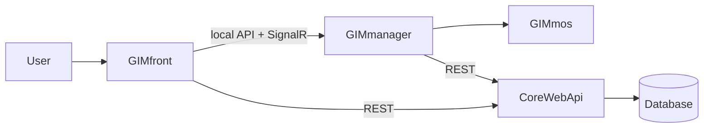

# GIM Workspace

This file is the central cross-repository map for the GIM mega workspace.

The workspace file lives next to this document at `GIMmos.code-workspace`.

## Workspace Layout

Public multi-root folders (see `GIMmos.code-workspace`):

- `./` -> `GIMmos`
- `../GIMmanager`
- `../CoreWebApi` (planned rename: **GIMapi**)
- `../GIMocctWrapper`

Related repositories that may appear in docs and project references:

- `../GIMzip` — proprietary binary layer (see [PROPRIETARY_COMPONENTS.md](PROPRIETARY_COMPONENTS.md))
- `../GIMfront` — browser UI (often developed alongside the stack above)

Some historical solution/project references use `GimZip` while the folder is `GIMzip`. On Windows this is usually harmless, but document and review paths carefully when adding new references.

## Repository Roles

- `GIMmos` owns CAD-level operations: reading, transforming, converting, and writing files. It builds the main DLLs that other projects depend on. The canonical CAD data model is `GimData`, defined in `GIMCompress`.
- `GIMmanager` is the local pseudo-backend installed on the user's machine. It exposes `GIMmos` functionality to the desktop/web workflow, offloads CPU-heavy CAD work away from the remote server, caches local CAD data, stores local project settings, and coordinates autosync.
- `CoreWebApi` (future **GIMapi**) is the remote backend running on the server. It is the only project that may communicate directly with the database. It owns CRUD flows, user/project/object metadata, and cloud-hosted files. It does not perform CAD processing itself.
- `GIMfront` is the React frontend. It talks to `CoreWebApi` for CRUD and remote application data, and to `GIMmanager` for CAD-related operations, local workflows, and progress/status updates.
- `GIMzip` owns the proprietary binary compression layer around `GimData` such as `GIMbin`. Treat implementation details of these formats as confidential. Public builds restore `GimBin` and `GimCrypt` from nuget.org when the `GIMzip` projects are absent, this repo pins 1.0.10, and a checkout with those projects uses the project references. See [PROPRIETARY_COMPONENTS.md](PROPRIETARY_COMPONENTS.md) for licensing and issue routing.
- `GIMocctWrapper` provides OCCT-based STEP/IGES interop used by `GIMmos` conversion flows.

## Routing Rules

- Any direct CAD logic belongs in `GIMmos` and should normally be reached through `GIMmanager`.
- Tasks that skip CAD and only touch CRUD, API, or database-backed state belong in `CoreWebApi`.
- Tasks that need both CAD processing and remote persistence should start in `GIMmanager`, then call `CoreWebApi` as needed.
- Cache-friendly tasks such as downloads and repeated local file loads should prefer `GIMmanager` so they can benefit from local cache and state.
- Purely visual or interaction-only behavior in the browser belongs in `GIMfront`.
- Start in `GIMzip` when a feature changes proprietary binary serialization or cryptographic helpers behind the internal GIM binary formats (maintainers with source access).

## Integration Notes

- `GIMfront` communicates with `GIMmanager` through local API calls plus SignalR for progress, status, and related live updates.
- `GIMfront` communicates with `CoreWebApi` through HTTP API calls for standard application CRUD and remote data.
- `GIMmanager` communicates with `CoreWebApi` when a flow combines local CAD work with server-side persistence or sync.
- If `GIMmanager` is not running, `GIMfront` may fall back to server-hosted representations for viewing, but some capabilities are reduced or unavailable.
- Uploaded files are processed into internal GIM formats through the local CAD path before the remote backend persists the resulting data.

## Code search

Agents search across the mega workspace using **semble** (semantic) and **grep** (literal). Semble is installed in `GIMmos` (`pyproject.toml`); **always run it as** `uv run semble …` **from the `GIMmos` repo root**, passing the target repo path as the last argument (e.g. `uv run semble search "jwt login" ../CoreWebApi`).

Full rules and commands: [`.agents/skills/workspace-code-search/SKILL.md`](.agents/skills/workspace-code-search/SKILL.md) in `GIMmos` (activate when searching by intent).

## Agentic contribution loop

For multi-step GIM work spanning this workspace, prefer `/gim-orchestrate` in `GIMmos` ([`.agents/skills/gim-orchestrate/SKILL.md`](.agents/skills/gim-orchestrate/SKILL.md)). Prefs, agent roster, and ADRs live under `GIMmos` (`.agents/`, `docs/adr/`, `docs/plans/`). The fleet runs on **both** Cursor ([`.cursor/agents/`](.cursor/agents/)) and OpenCode ([`.opencode/agents/`](.opencode/agents/)); see [`docs/guides/0000-setup-opencode.md`](docs/guides/0000-setup-opencode.md) for OpenCode install/`OPENCODE_CONFIG` and [`docs/adr/agents/0002-AGENTS-opencode-fleet-dual-home.md`](docs/adr/agents/0002-AGENTS-opencode-fleet-dual-home.md) for dual-home sync rules.

## Working Across Repositories

- Start in `GIMmos` when a feature changes file parsing, conversion, geometry handling, `GimData`, or format adapters.
- Start in `GIMmanager` when a feature changes orchestration on the user's machine, local caching, desktop integration, local API endpoints, or SignalR updates.
- Start in `CoreWebApi` when a feature changes API contracts, authentication, CRUD rules, database behavior, or remote file management without CAD processing.
- Start in `GIMfront` when a feature changes the browser UI, client-side UX, or front-end behavior that does not require changing CAD algorithms.
- Start in `GIMzip` when a feature changes binary serialization, compression, or cryptographic helpers behind the internal GIM binary formats.

## Cross-repo references

- A doc, ADR, or plan cited by index inside its own repo does not need the repo name.
- A doc, ADR, or plan cited by index from another repo must name that repo or give its path, such as `GIMmos/docs/plans/0005-local-stack.plan.md`.
- In a pull request body, parallel PRs or issues in another repo need full GitHub URLs; `#43` only links within current repo.
- A Jira ticket key does not identify a repo. Always include repo name or link with ticket.

## Local stack runbook

Process wiring for independent local development is documented in [`docs/guides/0003-local-stack.md`](docs/guides/0003-local-stack.md); production/test defaults remain unchanged.

## Quick Flow Diagram

