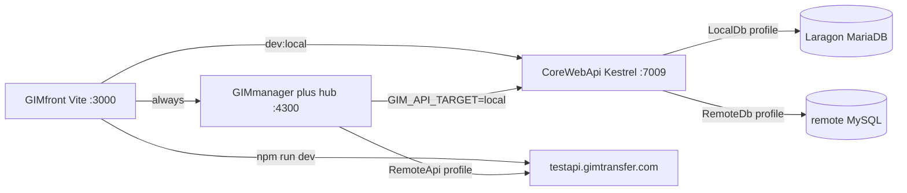

# Plan 0005: Local stack process wiring

> **Executor notice:** You did **not** participate in the design conversation. This document is the sole source of truth. Do not re-grill locked decisions. Do not invent new rules or mechanisms not listed here. If something is ambiguous *inside* this plan, ask the user once; otherwise implement as written.
>
> **Primary home:** `GIMtransfer` (workspace hub; impact split across three product repos).
>
> **Thin pointers:** [`../CoreWebApi/docs/plans/0002-local-stack.plan.md`](../../../CoreWebApi/docs/plans/0002-local-stack.plan.md), [`../GIMfront/docs/plans/0001-local-stack.plan.md`](../../../GIMfront/docs/plans/0001-local-stack.plan.md), [`../GIMmanager/docs/plans/0001-local-stack.plan.md`](../../../GIMmanager/docs/plans/0001-local-stack.plan.md).
>
> **Jira:** [GIM-139](https://gim.atlassian.net/browse/GIM-139) tracks this plan. Embed the key in `feature/gim-139-local-stack`. The initial docs-only branch was `feature/local-stack` until the ticket existed.
>
> **Repo roots (Windows / PowerShell):** `D:\Work\GIM\GIMtransfer`, `D:\Work\GIM\CoreWebApi`, `D:\Work\GIM\GIMfront`, `D:\Work\GIM\GIMmanager`.
>
> **Prefs:** `.agents/agent-prefs.md` — `architecture: windows`; `verify_per_step` / `commit_per_step` / `pr_per_step` true; `critic_per_step: granular`; `critic_reruns_per_step: one`. Honor `pr_per_step: offline` if the user confirms that for this plan.

---

## Execution mode

- [x] Verify per step
- [x] Commit per step
- [x] PR per step
- [x] Critic per step (`granular`, `critic_reruns_per_step: one`)

This plan has 4 step groups. Prefs already enable PR-per-step.

## Failure scenarios

- Agent moves to step N+1 while the touched repo is broken after step N.
- (verify ON) Agent moves to step N+1 without verifying step N, or commits/PRs before verify.
- (commit-per-step ON) Agent moves to step N+1 without committing step N, or commits while broken.
- (PR-per-step ON) Agent moves to step N+1 without opening a PR for step N.
- (critic-per-step ON) Agent moves to step N+1 without running gim-critic on step N.
- Order broken (commit before verify, PR before critic).
- Agent implements nasFlask, SQL seed, upload-folder layout, or `isProduction` enum rewrite (out of scope).
- Agent puts remote hosts/passwords in a committed template.
- Agent ships `GIM_API_TARGET=local` but leaves `GIMmanager/GIM.SignalRHub.API/Controllers/FileController.cs` hardcoded `testapi`/`api.gimtransfer.com` bases (those calls would still miss localhost).
- Agent changes production/test **defaults**: new required server env var, `git rm --cached` of `appsettings.secret.json`, edits to `.env.production` / `npm run build`, GIMdeploy pipelines, or `TestApi`/`prodApi` URL values. When `GIM_SECRET_FILE` and `GIM_API_TARGET` are unset, behavior must match today.

## Locked decisions

- **DB:** Laragon-hosted MariaDB **10.5.18**. Recommend Laragon in the runbook. **No seed SQL in this plan.**
- **Secret files:** one committed template `CoreWebApi/GIM.WebAPI/GIM.WebAPI/appsettings.secret.template.json` (shape only). Developers copy it to `appsettings.secret.local.json` (Laragon; **gitignored in this plan**). Remote DB keeps today's `appsettings.secret.json` (still tracked until SD-007). Same key shape. Production hosts keep using their existing `appsettings.secret.json` with no new filename and no `GIM_SECRET_FILE`.
- **CoreWebApi switch:** VS/`launchSettings.json` profiles. Keep existing `https` as default (still loads `appsettings.secret.json`). Add sibling `LocalDb`. Both `ASPNETCORE_ENVIRONMENT=Development`, both Kestrel **`https://localhost:7009`**. `LocalDb` sets `GIM_SECRET_FILE=appsettings.secret.local.json`. Do **not** introduce `Environment=Local`. IIS Express `:44325` is leftover, not documented.
- **GIMfront switch:** keep `npm run dev` → remote test API (`GIMfront/.env.development`). Add `npm run dev:local` → Vite `--mode localapi` + committed `.env.localapi` pointing at `https://localhost:7009`. GIMmanager stays hardcoded `http://localhost:4300`.
- **GIMmanager switch:** do **not** rewrite `isProduction`. Add `LocalApi.URL=https://localhost:7009/` in `GIMmanager/GIM.SignalRHub.API/appsettings.json`. VS profiles `RemoteApi` / `LocalApi`; `LocalApi` sets `GIM_API_TARGET=local`. When local: force test-shaped paths (`isProduction=false`) and overwrite `testwebapiurl` with `LocalApi.URL` so existing `isProduction ? prod : test` call sites (including `WebApiService.Http`) hit localhost without a 3-way enum. `FileController.cs` currently **hardcodes** `https://testapi.gimtransfer.com/` / `https://api.gimtransfer.com/` (ignores appsettings) — those two bases must read the same URL repository so LocalApi is not a partial lie. `SomeFilterAttribute` can rewrite `%AppData%\GIM\GIM.json` `isProduction` from the GIMfront header; when `GIM_API_TARGET=local`, keep `isProduction=false` (do not let a prod-build header flip the process onto `prodApi.URL`).
- **Scope:** process wiring only. nasFlask, NAS `FolderSettings` paths, SMTP/SendGrid, LinkedIn, and DB seed are documented gaps, not work.
- **GIMtransfer:** class library, not a server. This plan does not change CAD code. GIMmanager still consumes NuGet `GimTransfer`; stepping into CAD from the desktop app is out of scope.
- **Debug/Hot Reload:** no mega compound launcher and no Docker. Each process F5 / `npm run` on its own.
- **Production deploy invariance:** local targeting is **opt-in only** (`GIM_SECRET_FILE`, `GIM_API_TARGET=local`, `npm run dev:local`). Unset env = today's production/test server and shipped-desktop behavior. No GIMdeploy YAML/pipeline changes. No new IIS/Kestrel/systemd settings on test or prod hosts. Do **not** fold SD-007 `git rm --cached` / fail-loud overlay into this plan. Gitignore **only** the new `appsettings.secret.local.json`. Keep loading `appsettings.secret.json` as today (`optional: true`, same filename) when the env var is absent. Do not edit `GIMfront/.env.production` or the `build` script. Do not change committed `TestApi.URL` / `prodApi.URL` values. `FileController` may read those appsettings keys instead of literals **only if** the resolved URLs are identical when `GIM_API_TARGET` is unset (`https://api.gimtransfer.com/` / `https://testapi.gimtransfer.com/`). Adding unused `LocalApi.URL` to GIMmanager appsettings is allowed (dead key unless the env is set).

**Canonical local URLs**

- GIMfront: `https://localhost:3000` (Vite `basicSsl`)
- CoreWebApi: `https://localhost:7009`
- GIMmanager hub: `http://localhost:4300`
- MariaDB: Laragon default `127.0.0.1:3306`

## What already exists (do not reinvent)

- CoreWebApi already overlays `appsettings.secret.json` in `GIM.WebAPI/GIM.WebAPI/Program.cs` (`AddJsonFile` + `AddEnvironmentVariables`). Connection strings live in that overlay. CORS already allows `https://localhost:3000`.
- SD-007 (secret overlay gitignore / fail-loud / template) is a **related** CoreWebApi plan. This work may **add** a template and `appsettings.secret.local.json` gitignore, but it **must not** untrack `appsettings.secret.json` or make it required at host start. That remains SD-007 so production publish output and GIMdeploy `push_app_configs` stay as they are.
- GIMfront already has `.env.local.test` aimed at IIS `:44325` with no npm script and missing `VITE_FILEUPLOAD_DOMAIN`. Replace, do not keep as the documented path.
- GIMmanager already embeds the SignalR host in the WinForms process (`GIMmanager/frmMain.cs` ~160). Debug GIMmanager only; do not also F5 `GIM.SignalRHub.API` (port **4300** clash). Hub `Properties/launchSettings.json` `5000/5001` is unused when embedded — runbook must not tell people to use it.
- WinForms reads `Directory.GetCurrentDirectory()/appsettings.json`. Implementation must **copy/link** `GIM.SignalRHub.API/appsettings.json` into the GIMmanager output dir if that copy is not already reliable.
- SendEmailScheduler already shows a localhost example DB name `gimtest` — use that as the Laragon placeholder database name in the CoreWebApi secret template comments (not a live remote string).
- CoreWebApi **MySQL must answer at boot** (`ServerVersion.AutoDetect` on `GIMConnection`). EF `InitUser` migration is not the real schema (~140 SPs); seed still deferred.

## Known gaps (document only)

- Empty local DB: API process can start (`ServerVersion.AutoDetect`) once MariaDB is up and the named databases exist; login/CRUD fail until the future seed.
- Maps/files still hit NAS / `ExternalEndpoints.MapFiles`.
- JWT: `appsettings.secret.local.json` signing key must match GIMmanager `JwtAuthentication:Secret` or desktop→local-API tokens fail. Guide will say so; no key rotation here.
- 

login cookies use domain `.gimtransfer.com` — local login may need the existing token-in-localStorage path, not cookie restore.

## Preflight warning

GIMtransfer and CoreWebApi working trees were dirty at plan-authoring time (including SD-007 overlay files). Implementation **stops** until those repos are clean (no stash/reset). Fold any in-progress overlay helper into step B1 rather than inventing a second loader.

---

### Step A1 — docs: ADR, glossary, runbook [critic, verify, PR]

Orchestrator-owned (not builder). Docs-only exception on `feature/local-stack`.

- **Files / symbols:** `../CoreWebApi/docs/adr/0004-local-db-secret-overlay.md`; `../GIMmanager/docs/adr/0001-local-api-target.md`; `.agents/CONTEXT.md` (Local stack terms only — fleet vocabulary stays); `../CoreWebApi/CONTEXT.md` (`LocalDb`, `RemoteDb`, `Secret overlay file`); `docs/guides/0003-local-stack.md` (new); `WORKSPACE.md` (pointer to the guide); `../GIMfront/docs/guides/0001-local-stack.md` (new); `../GIMfront/docs/README.md` (guide pointer). Thin pointer plans remain included in the initial docs commits.
- **Change:** Record opt-in profiles + env overlays + npm modes; production defaults unchanged; rejected Docker / `Environment=Local` / 3-way `isProduction` / SD-007 untrack-in-this-plan. Keep browser-client instructions in the browser-client repository. Runbook: Laragon 10.5.18, copy template → `appsettings.secret.local.json`, F5 recipes, local API targeting, external endpoint limitations, and do not start the standalone SignalR host beside the desktop process.
- **Validate:** Open the ADR, workspace runbook, glossaries, and browser-client guide; confirm no remote hosts/passwords; confirm production-invariance paragraph matches locked decisions.
- **Commit message:** `A1: added local-stack ADR, glossary, and runbook`

### Step B1 — CoreWebApi LocalDb profile [critic, verify, PR]

- **Files / symbols:** `../CoreWebApi/GIM.WebAPI/GIM.WebAPI/Properties/launchSettings.json`; `../CoreWebApi/GIM.WebAPI/GIM.WebAPI/Program.cs` (`AddJsonFile` overlay); `../CoreWebApi/.gitignore`; `../CoreWebApi/GIM.WebAPI/GIM.WebAPI/appsettings.secret.template.json` (new or complete); unit tests under `../CoreWebApi/tests/UnitTests/` for secret-file name selection. Reuse `SecretConfigurationFile` only if it already exists and does not fail-loud-require the overlay.
- **Change:** Keep the existing `https` profile as the default (same URLs, still loads `appsettings.secret.json`). Add sibling `LocalDb` with `GIM_SECRET_FILE=appsettings.secret.local.json`. If `GIM_SECRET_FILE` is set, `AddJsonFile` that name; else keep today's `appsettings.secret.json` / `optional: true` / `AddEnvironmentVariables()` order. Gitignore **only** `appsettings.secret.local.json`. Do not `git rm --cached` the tracked secret file. Template stays placeholders (Laragon-shaped examples OK: `127.0.0.1`, `CHANGE_ME` password, DB name `gimtest`) — **never** remote hosts.
- **Validate:** `dotnet test` on the new/updated unit tests (no live MySQL). Unset env → default filename; set env → that filename. `git check-ignore` matches `appsettings.secret.local.json` and does **not** newly ignore the tracked `appsettings.secret.json`.
- **Commit message:** `B1: added CoreWebApi LocalDb launch profile and local secret overlay`

### Step C1 — GIMfront local API script [critic, verify, PR]

- **Files / symbols:** `../GIMfront/package.json` (`scripts.dev` unchanged; add `dev:local`); `../GIMfront/.env.localapi` (new); `../GIMfront/.env.local.test` (retire as documented path — delete or leave undocumented); `../GIMfront/README.md` (one-line pointer to the workspace runbook if it already mentions `npm run dev`).
- **Change:** Committed `.env.localapi`: `VITE_EXTERNAL_API` / `VITE_BE_DOMAIN` / `VITE_FILEUPLOAD_DOMAIN` → `https://localhost:7009/...`; domain/redirect → `https://localhost:3000/...`. Script: `"dev:local": "vite --mode localapi --debug"`. Do not name the committed file `*.local` (gitignore). Do not edit `.env.production` or `build`.
- **Validate:** Inspect env keys vs `.env.development` (same keys, local values). `npm run dev` still documented as remote test API.
- **Commit message:** `C1: added GIMfront npm run dev:local for local CoreWebApi`

### Step D1 — GIMmanager LocalApi profile [critic, verify, PR]

- **Files / symbols:** `../GIMmanager/GIM.SignalRHub.API/appsettings.json` (`LocalApi.URL`); `../GIMmanager/GIMmanager/Services/ConfigurationService.cs` (`GetAllUrls`); `../GIMmanager/GIMmanager/Properties/launchSettings.json`; `../GIMmanager/GIM.SignalRHub.API/Controllers/FileController.cs` (the two hardcoded base URL fields / call sites only); `../GIMmanager/GIM.SignalRHub.API/SomeFilterAttribute.cs`; `../GIMmanager/GIMmanager/GIMmanager.csproj` (copy/link hub `appsettings.json` into WinForms output if needed).
- **Change:** `LocalApi:URL=https://localhost:7009/`. `GetAllUrls()` honors `GIM_API_TARGET=local` (overwrite `testwebapiurl`, force `isProduction=false`). `LocalApi` launch profile sets that env; `RemoteApi` / current `GIMmanager` profile leaves it unset. Point `FileController` hardcoded test/prod bases at the URL repository (minimal: those two string fields / call sites, not a FileController rewrite). Guard `SomeFilterAttribute` so local target is not overwritten to production. Do not change committed `TestApi.URL` / `prodApi.URL` values. No new test project.
- **Validate:** Inspect URL overwrite + FileController fields resolve to the same two remote hosts when the env is unset. Documented F5 recipe in the runbook (A1) still matches.
- **Commit message:** `D1: added GIMmanager LocalApi launch profile targeting localhost CoreWebApi`

## Review

After execution, run `/review-with-critic granular` once more after the last per-step critic pass, with the full modified file list and `Steps implemented: A1, B1, C1, D1`. That wrap-up pass weights cross-step coherence (secret filename vs GIMfront `:7009` vs GIMmanager `LocalApi.URL`).
