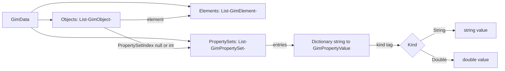

# Plan 0008: GIMproperties in GimData (GIMtransfer side)

> **Executor notice:** You did **not** participate in the design conversation. This document is the sole source of truth. Do not re-grill locked decisions. Do not invent new rules or mechanisms not listed here. If something is ambiguous *inside* this plan, ask the user once; otherwise implement as written.
>
> **Primary home:** `GIMtransfer` (single-repo plan; the GIMbin v3 byte work lives in `GIMzip` under its own plan — this plan states only the behavioral contract it assumes, §GIMbin contract, plus a pointer).
>
> **Repo root (Windows / PowerShell):** `C:\Users\SBS\Desktop\Work\GIM\GIMtransfer`.
>
> **Prefs:** `.agents/agent-prefs.md` — `architecture: windows`; `verify_per_step: true`; `commit_per_step: true`; `pr_per_step: true`; `critic_per_step: granular`.
>
> **No tracker ticket:** single repo, docs + code in `GIMtransfer` only. The GIMzip session tracks its own work.

This plan has 10 steps across 4 groups. PR-per-step is on so each chunk gets reviewed independently: each step lands on a chained branch `gimpropertyset/<stepid>-<title>` (e.g. `gimpropertyset/a1-model`) with base the previous step branch (first step: `feature/gimpropertyset`).

D1 (specs + read-philosophy ADR) runs immediately after A1, before A2 — the documented rules must exist before any consumer code is written against them.

## Execution mode

- [x] Verify per step
- [x] Commit per step
- [x] PR per step (chained; normal merge commits, no squash)
- [x] Critic per step (`granular`)

Step order is critic → verify with user → commit → PR. No step advances without its PR.

## Failure scenarios

- Agent moves to step N+1 while the touched area is broken after step N.
- (verify ON) Agent moves to step N+1 without verifying step N, or commits before verify.
- (commit-per-step ON) Agent moves to step N+1 without committing step N, or commits while broken.
- (PR-per-step ON) Agent moves to step N+1 without opening a PR for step N (chained base: previous step branch; first step: `feature/gimpropertyset`).
- (critic-per-step ON) Agent moves to step N+1 without running gim-critic on step N.
- Order broken (commit before verify, PR before critic).
- Agent changes an existing `GimElementType` structure, integer value, or int/double/byte count (backwards-compatibility rule, `docs/specs/gimdata/README.md`).
- Agent changes `GimObject.ToString()` format (3 call sites depend on it: `JsonReaderV1_1_2_Older.cs`, `ReadCityJson.cs`).
- Agent stores GIMbin table indices inside `GimData` (indices live in GIMbin bytes only).
- Agent makes any property key mandatory in validation, or assumes key 0/1 present per set.
- Agent silently drops properties on any **new-format** conversion path (must fail loud instead). Dropping properties when an **old reader** meets new data is specified tolerance (decision 12), not a failure.
- Agent resolves a corrupt property-set index with silent fallback (must fail the read). A **missing** property section in old-reader hands is tolerance (decision 12), not corruption.
- Agent documents GIMbin byte layout/compression internals in this repo (behavior-only contract + pointer; byte spec lives in the GIMzip plan).

## Locked decisions (why each was made)

| # | Decision | Why (CodeGraph evidence) |
|---|----------|--------------------------|
| 1 | Parallel `GimData.PropertySets: List<GimPropertySet>`, set = `Dictionary<string, GimPropertyValue>` | `GimData` (`GIMCompress/entities/GimData.cs:15`) is three parallel lists (`objects`, `elements`, `joints`). A fourth parallel list follows the established pattern and leaves the element index graph untouched. Impact of changing `GimData` is 446 symbols — so the change must be purely additive. |
| 2 | Nullable link on `GimObject` (`int? PropertySetIndex`, null = none, many-to-one), constructed via a unified `GimObjectFactory` | `GimObject` (`GIMCompress/entities/GimObject.cs:3`) has ~11 raw-initializer construction sites (`FileManagerPrivate.cs`, `FindSpaceStructure.cs`, `ReadCityJson.cs`, +2 more; only pseudo-factory is `PrepareMapObject`, `FileManagerPrivate.cs:2494`). A1 adds `GimObjectFactory.Create(element, name, propertySetIndex: null)` and migrates all sites onto it, so future field additions touch one spot. The link points into `PropertySets`, **not** `Elements`, so `RemoveElements` (`GimData.cs:214`, 5 callers), `RemoveElementsAndTheirChildren` (`GimData.cs:411`, 25 callers), `AddSecondaryGimData*`, `DemoteExternalReference` never touch it. Rejected: separate `GimData` dictionary keyed by object index (every `Objects.RemoveAt` in `RemoveElementSubTree` (`GimData.cs:340`) would shift keys — 28 dependent symbols in the `GetElementToObjectDict` blast radius) or by element index (adopts the full 25+ element-remap blast radius for zero extra capability). No fluent-builder framework (curve-style builders exist for elements only; a 4-field class needs a factory, not a DSL). |
| 3 | Kind-tag-per-value (`String`\|`Double`) | Each value decodes on its own without consulting keys first (a bare index is ambiguous across the string/number value domains). Real data is dirty — the same key arrives as text or as a number. Rejected: per-key-type (rejects those dirty files) and split string/numeric dicts (breaks the 0/1 ordering convention and splits atomic CRS updates across dicts). Real savings come from shared sets. |
| 4 | Numbers start as `String \| Double` only; ints fold into the double path | The existing double lookup already funnels integer values through the double path. No new numeric path needed now; the tag extends to a 2-bit `String\|Double\|Int\|Bool` enum later without restructuring. |
| 5 | Nothing mandatory in validation; `name`/`type` reserved at key-table 0/1 **when present** | User requirement (sets hold arbitrary payloads). 0/1 is an encoding-order convention for the GIMbin key table, not a per-set requirement — readers must never assume presence. |
| 6 | Precedence: set-`name` wins when present, else `GimObject.name` | Keeps both names without a two-writer split: one rule, written into `docs/specs/gimdata/README.md` + JSON README so every reader/writer/UI path agrees. Same idea for `type`. |
| 7 | `GimData` stays human-readable; indices exist only in GIMbin bytes | Gives the requested decode-on-the-fly for free (`DecodePropertySet` returns `{"name": String("LED"), ...}`, never `0=>1`). |
| 8 | JSON carries set-index references, not inline dicts — but DTOs stay inline-capable | JSON mirrors the model: one root `propertySets` array, objects point in — dedup survives the round trip without a re-dedup pass (`GimJsonToGimData`, `FileManagerPrivate.cs:1804` → `JsonChildrenUpdate`, `:1589`). Precedent: root-owned `GIMbin` blob, `Materials`, `Joints` with child references; nullable + omitted-when-empty per the `JsonManager/README.md` null-safety contract. Inline would duplicate the LED-streetlight set N× per payload. `JsonGimPropertySet` still serializes as a standalone dict object, so a future writer can embed it per-child with no model change if the decision ever flips. |
| 9 | Corrupt set index fails the read; **absent** property data in old-reader hands is tolerated | Silent fallback on corrupt data would violate decision 6 unpredictably — same severity as a bad `GimObject.element`. But an old reader meeting new data (decision 12) degrades: geometry + names decode, properties dropped. |
| 10 | No `Clone()` work, no auto-GC of orphan sets | `GimData.Clone()` (`GimData.cs:498`) already omits `joints` and is effectively unused — out of scope per user. Removing a `GimObject` leaves its set orphaned (harmless); no pruning, so no link-remap risk. Shared sets are immutable-on-share by convention (one spec line, no code). |
| 11 | JSON schema `1.3.0`, GIMbin version byte `3` | Additive minor bump follows the Materials precedent (`1.2.0`, threshold `V1_2`, `JsonReaderV1_2 : JsonReaderV1_1_2_Older`). GIMbin dispatches on the leading version byte (existing versioned-reader path) — v1/v2 paths byte-identical. |
| 12 | Old readers tolerate new property data (ignore-and-succeed); fail-loud is for corrupt data only | Versioned readers, not versioned writers: any reader reads any file to the most modern standard it understands, even when data is missing. JSON: pre-1.3 readers never look at the unknown `PropertySets`/`PropertySetIndex` keys, so they succeed with names only (the 1.3.0 version gate is scoped to additive tolerance — see B3). GIMbin: v3 lays the property section out as a trailing framed section (GIMzip plan) so v1/v2 readers stop early and succeed; the version-mismatch throw remains only as fallback. File-global properties ride the root object's set (element 0 via `GetElementToObjectDict`, `GimData.cs:484`) — zero new machinery; root-element elision itself stays a GIMzip-side decision, with the behavioral requirement that object 0's link survives the round trip. No pre-existing string table exists (names are written inline today) — confirmed against the GIMzip checkout; the v3 string tables are genuinely new. |

## Design

### In-memory model



`GimObject.element` (existing, into `Elements`) and `GimObject.PropertySetIndex` (new, into `PropertySets`) are independent axes. Element add/remove/reorder never shifts property links. Many objects may share one set index (dedup).

### Kind-tagged value (the core idea)

```csharp
// GIMCompress/entities/GimPropertyValue.cs (new) — APPROACH NOTE (builder: keep this comment):
// Each property value carries its own kind tag, so the decoder knows which
// lookup table to hit WITHOUT joining the key table first (a bare index is
// ambiguous: string-table[3] and double-table[3] are different values).
//   0 = String → index into the GIMbin string-value table (GIMzip v3+).
//   1 = Double → pointer into the shared double lookup table (existing path;
//       ints fold in here too).
// EXTENSION PATH: if Int/Bool (or other kinds) are needed later, widen this
// to a 2-bit enum (00=String, 01=Double, 10=Int, 11=Bool). Per-value tags mean
// no key-table restructure and no migration of existing entries — readers that
// predate a new tag reject it loudly instead of misdecoding.
public enum GimPropertyKind { String = 0, Double = 1 }

public readonly struct GimPropertyValue
{
    public GimPropertyKind Kind { get; }
    public string StringValue { get; }   // valid iff Kind == String
    public double DoubleValue { get; }   // valid iff Kind == Double
    public static GimPropertyValue FromString(string v) => ...;
    public static GimPropertyValue FromDouble(double v) => ...;
}

// GIMCompress/entities/GimPropertySet.cs (new)
public class GimPropertySet : IReadOnlyGimPropertySet
{
    public Dictionary<string, GimPropertyValue> Entries = new();
    // ToString() returns the human-readable decode, e.g.
    // {name:String("LED"), LED_TYPE:String("COB LED"), Geolocation_X:Double(190000)}
}
```

### Worked example (the LED case, end to end)

In `GimData` (human-readable, what the debugger shows):

```csharp
// GimData.PropertySets[0]
{
  "name":            String("LED"),
  "type":            String("electrical_component"),
  "LED_TYPE":        String("COB LED"),
  "Geolocation_X":   Double(190000),
  "Geolocation_Y":   Double(400000),
  "coordinate_type": String("RD")
}
// GimObject[i] = { name: "door-17", element: 42, propertySetIndex: 0 }
// display name resolves to "LED" (set wins); without the link it stays "door-17".
```

Shape detail on the binary side lives only in GIMzip's plan (pointer above) — this repo holds no format layout.

In JSON 1.3.0 (plain key-val shape — amendment 10: quoted = String kind, bare number = Double kind; the kind lives in the model, not the wire):

```json
{
  "Version": "1.3.0",
  "PropertySets": [
    { "name": "LED",
      "type": "electrical_component",
      "LED_TYPE": "COB LED",
      "Geolocation_X": 190000,
      "Geolocation_Y": 400000,
      "coordinate_type": "RD" }
  ],
  "Children": [ { "Name": "door-17", "PropertySetIndex": 0, "...": "..." } ]
}
```

### Version matrix

| Producer | JSON schema | Binary format | Old-reader behavior |
|----------|-------------|---------------|---------------------|
| Before this plan | ≤ 1.2.0 | older (GIMzip-owned) | unchanged |
| After this plan (no properties) | 1.3.0 always — no `PropertySets` key emitted when empty (amendment 9; the version stamp never downgrades) | current (GIMzip-owned) | unchanged |
| After this plan (with properties) | 1.3.0 | current (GIMzip-owned) | **Ignore-and-succeed** (decision 12): JSON pre-1.3 readers decode geometry + names, drop properties; binary old-version readers read their own version only. Fail-loud only for corrupt data. |

## GIMbin behavior (pointer only — redacted 2026-10-04 per Anis review)

GIMbin is a closed, proprietary repo; its design and format live only in **GIMzip's "GIMbin v3 — property-set serialization" plan** (repo `GIMzip`, title as stated — no path, no filename). This repo may only assume that GimBin turns `GimData` into a binary and back. The behavioral assumptions this plan needs:

1. Property sets and per-object links survive the binary round trip (including object 0 / the root object's link for file-global properties).
2. Old files stay readable by their own version readers into a modern `GimData` (geometry + names; properties absent = tolerated).
3. Corrupt property data fails the read loudly; silent fallback is forbidden.
4. Version/format policy (including when the format version changes) is owned entirely by GIMzip.

## Steps

### Step A1 — model types + GimData/GimObject wiring + factory [critic, verify, commit, PR]

- **Files / symbols**: new `GIMCompress/entities/GimPropertyValue.cs` (`GimPropertyKind`, `GimPropertyValue` per §Design incl. the APPROACH NOTE comment verbatim in spirit), new `GIMCompress/entities/GimPropertySet.cs` (`GimPropertySet`, `IReadOnlyGimPropertySet`) + small set-builder helper (`GimPropertySet.Create(...)` / `AddString`/`AddDouble`); `GIMCompress/entities/GimData.cs` (`GimData:15` — add `propertySets` field + `PropertySets` property + explicit `IReadOnlyGimData` exposure); `GIMCompress/entities/GimObject.cs` (`GimObject:3` — add `int? propertySetIndex` field + `PropertySetIndex` property, extend `Clone()` at `:37`); new `GIMCompress/entities/GimObjectFactory.cs` (`Create(element, name, propertySetIndex: null)` universal constructor); `GIMCompress/entities/interfaces/ReadOnlyGimData.cs`, `ReadOnlyGimObject.cs` (getters only); migrate all ~11 raw `new GimObject` sites + `PrepareMapObject` (`FileManagerPrivate.cs:2494`) onto the factory.
- **Change**: Purely additive model surface. Defaults: empty set list, null link — every migrated call site behaves identically. `GimPropertySet.Entries` defaults to an empty dictionary, never null.
- **Why**: Decisions 1 + 2 — parallel list keeps the 446-symbol `GimData` blast radius additive; nullable object-side link avoids all element-remap paths; factory funnels future field additions (incl. the old-reader name-only path, decision 12) through one spot.
- **Validate**: `dotnet build "GIMCompress/GIMCompress.csproj" -c Debug -p:Platform=x64`
- **Commit message**: `A1: added GimPropertyValue/Set model, GimData.PropertySets and GimObject link`
- **Branch / PR**: branch `gimpropertyset/a1-model` from `feature/gimpropertyset`; PR `--base feature/gimpropertyset`.

### Step A2 — decode + name/type precedence helpers [critic, verify, commit, PR]

**Requires:** D1 merged (precedence + tolerance rules are written before this consumer code).

- **Files / symbols**: new `GIMCompress/entities/GimPropertyHelpers.cs` (or `GimPropertyExtensions.cs`): `DecodePropertySet(GimData, int)` → human-readable `IReadOnlyDictionary<string, GimPropertyValue>` (throws on out-of-range index); `ResolveDisplayName(GimData, uint objectIndex)` (set-`name` string wins when link valid and entry present and `Kind == String`, else `GimObject.name`); `TryGetPropertyString(GimData, uint objectIndex, string key, out string)` (same pattern, reused for `type`); `GimPropertySet.ToString()` debug rendering `{k:Kind(v), ...}`.
- **Change**: New code only. `GimObject.ToString()` (`GimObject.cs:48`) is NOT touched (3 call sites). A non-`String` `name` entry never wins (kind guard) — it is ignored for display, not an error.
- **Why**: Decisions 6 + 7 — one precedence rule shared by all future call sites; debug decode without indices.
- **Validate**: `dotnet build "GIMCompress/GIMCompress.csproj" -c Debug -p:Platform=x64` plus a new `TestPlatform` test class (LED example from §Design: decode returns tagged values; display name `LED` with link, `door-17` without; non-string `name` ignored).
- **Commit message**: `A2: added property decode and display-name precedence helpers`
- **Branch / PR**: branch `gimpropertyset/a2-decode` from `gimpropertyset/d1-docs`; PR `--base gimpropertyset/d1-docs`.

### Step A3 — test support for properties [critic, verify, commit, PR]

- **Files / symbols**: `TestHelpers/Compare.cs` (`CompareObject:50` — also compare `PropertySetIndex`; new `ComparePropertySets` entry-wise incl. kind + value), `TestHelpers/Correctness.cs` (`CheckCorrectnessObjects:42` — link null-or-in-range; new set-entry sanity: non-empty keys, kind/value consistency).
- **Change**: Extend the two helpers every round-trip test funnels through (`CompareGimDatas`, `CheckCorrectnessGimData`). No production code.
- **Why**: Without this, binary/JSON round-trip tests pass while silently dropping properties (failure scenario).
- **Validate**: `dotnet test "TestPlatform/TestPlatform.csproj" -c Debug -p:Platform=x64` (existing suite green with empty property lists)
- **Commit message**: `A3: extended test Compare/Correctness to property sets and links`
- **Branch / PR**: branch `gimpropertyset/a3-test-support` from `gimpropertyset/a2-decode`; PR `--base gimpropertyset/a2-decode`.

### Step B1 — JSON model types [critic, verify, commit, PR]

- **Files / symbols**: `GIMCompress/entities/ClassesForGimJSON.cs` (`JsonGimObject:35` — add nullable `List<JsonGimPropertySet> PropertySets`; `JsonGimElement:199` — add `int? PropertySetIndex` following the `ObjectID`/`ProjectID`/`MaterialID` nullable pattern); new `JsonGimPropertySet` / `JsonGimPropertyValue` DTOs (in-memory kind + value; on the wire, plain key-val per amendment 10 and the §Design JSON example).
- **Change**: Nullable, default null — old payloads (no `PropertySets` key) materialize identically. `JsonGimPropertySet` serializes as a standalone dict object so a future inline-per-child writer needs no model change (decision 8 flip-ease).
- **Why**: Decision 8 — root-owned array + per-child index mirrors `Materials`/`MaterialID` (`JsonReaderV1_2:33`) and preserves dedup.
- **Validate**: `dotnet build "GIMtransfer/GIMtransfer.csproj" -c Debug -p:Platform=x64`
- **Commit message**: `B1: added JSON property-set DTOs and child link`
- **Branch / PR**: branch `gimpropertyset/b1-json-model` from `gimpropertyset/a3-test-support`; PR `--base gimpropertyset/a3-test-support`.

### Step B2 — JSON writer path [critic, verify, commit, PR]

- **Files / symbols**: `GIMtransfer/FileManager/FileManagerPrivate.cs` (`GetJsonGimData:896`, `GetObjectNameIfExists:1338`) — emit root `PropertySets` (omit key when `GimData.PropertySets` empty), per-child `PropertySetIndex` (omit when null), child `Name` via A2 `ResolveDisplayName` so set-`name` wins on export.
- **Change**: Empty-properties output is byte-identical to today (keys omitted). Non-empty output adds the two keys only.
- **Why**: Decisions 6 + 8 — single precedence rule applied at export; omission keeps the 1.2.0 shape for property-less files (version matrix).
- **Validate**: build `GIMtransfer.csproj` as above; extend/duplicate a `PromotionGlbReuseTests`-style JSON test (property-less output unchanged; LED fixture emits the §Design JSON).
- **Commit message**: `B2: write property sets and links to JSON with name precedence`
- **Branch / PR**: branch `gimpropertyset/b2-json-writer` from `gimpropertyset/b1-json-model`; PR `--base gimpropertyset/b1-json-model`.

### Step B3 — JSON 1.3.0 reader path [critic, verify, commit, PR]

- **Files / symbols**: `GIMtransfer/JsonManager/JsonVersionPolicy.cs` (`:24,:37` — add `V1_3 = 1.3.0`, bump `LATEST_SUPPORTED_JSON_VERSION`); `GIMtransfer/JsonManager/JsonManager.cs` (`SelectReader:46` — route `≥ V1_3` to new reader); new `GIMtransfer/JsonManager/JsonReaderVersions/JsonReaderV1_3.cs : JsonReaderV1_2` (override `ReadJsonCore`: chain `base` + `ReadPropertySets`; override `ReadJsonChild`: `+ PropertySetIndex`; stamp `Version` `V1_3`); `GIMtransfer/JsonManager/README.md` (dispatch + threshold tables), `GIMtransfer/JsonManager/VERSION_HISTORY.md` (new `1.3.0` row); `FileManagerPrivate.cs` (`GimJsonToGimData:1804` — after `JsonChildrenUpdate`, apply links with `?.Count > 0` null-guard per the null-safety contract; out-of-range index or kind/value mismatch throws, never falls back).
- **Change**: Follows the exact Materials-precedent extension procedure (`README.md` §"Adding a new schema version"). Pre-1.3 files behave identically. Pre-1.3 **readers** meeting 1.3.0 files ignore the unknown `PropertySets`/`PropertySetIndex` keys and decode geometry + names (decision 12 — the 1.3.0 gate is additive-tolerant, not a throw); legacy `GimObject` construction goes through the A1 factory with null link.
- **Why**: Decisions 8 + 9 + 11 + 12 — versioned, nullable, fail-loud on corruption, tolerant on absence.
- **Validate**: `dotnet test` JSON suites (`JsonVersionPolicyTests`, `JsonManagerReadGimJsonTests`) + new 1.3.0 reader tests (LED payload round-trips; corrupt index throws; missing key reads as legacy; 1.3.0 payload through the 1.2 reader yields names-only success).
- **Commit message**: `B3: added JSON 1.3.0 reader for property sets`
- **Branch / PR**: branch `gimpropertyset/b3-json-reader` from `gimpropertyset/b2-json-writer`; PR `--base gimpropertyset/b2-json-writer`.

### Step C1 — binary wiring against GIMbin v3 [critic, verify, commit, PR]

- **Files / symbols**: `GIMtransfer/FileManager/FileManagerPrivate.cs` (`GimDataToBinary:519`, `BinaryToGimData` in `FileManagerInternal.cs:561`) — pass the full `GimData` (now carrying `PropertySets`/links via `IReadOnlyGimData`) through the binary writer/reader per the §GIMbin contract; no filtering, no index translation on this side (table construction is GIMzip's).
- **Change**: A v1/v2 reader meeting v3 bytes stops before the trailing framed property section and succeeds with geometry + names (decision 12); the version-mismatch throw remains only as fallback. Corrupt property data throws. No silent property dropping anywhere on the new-format path.
- **Why**: Decisions 7 + 12 — this side stays human-readable; bytes are GIMzip's. Assumes the GIMbin behavioral contract (pointer section above).
- **Validate**: `TestPlatform` binary round-trip suites + new LED property round-trip (sets + links + shared-set identity survive the round trip). Amended 2026-10-02: `GimDataConversionTestsBinary`/`SimpleBinaryTests` live in **GIMzip** and are excluded from its test project — the format-level round-trip tests live in GIMzip's `GimBinV3Tests` (GIMzip plan 0001 S4); this plan's C1 tests cover the GIMtransfer wiring path only. The old "v3 bytes through v2 reader" tolerance test is dropped (old binaries out of scope, GIMzip ADR 0001).
- **Fold-in (user 2026-10-02, re-pointed per GIMzip plan 0001 decision 12):** fix the pre-existing NRE where `GetJsonGimData` (`FileManagerPrivate.cs:992`) reaches `GimBin.GimWriter.StringToBytes` (`GIMzip/GimBin/GimWriter.cs:947`) with a null name — `GetJsonGimData_EmitsPropertyLinkForChildBesideGeometryFilteredChild` (`TestPlatform/GetJsonGimDataPropertyTests.cs:148`) must go green. Root cause: `GimObject.name = null` (binary strings cannot encode null — `""` is "unnamed"). Fix at the model boundary: `GimObjectFactory.Create` coalesces `name` → `""` (`GIMCompress/entities/GimObjectFactory.cs:4-14`) + one spec line in `docs/specs/gimdata/README.md` ("`name` is non-null; empty string means unnamed"). The defensive writer-side seatbelt rides GIMzip plan 0001 **S1** — do not edit GIMzip from this plan.
- **Fold-in (Anis 2026-10-03, GIMzip PR #19 comment `4174825329`, amendment 9):** JSON envelope `Version` always stamps `1.3.0` — remove the conditional `1.2.0`-shaped emission (the `GetJsonGimData` version stamp) and update any test pinning the old conditional shape.
- **Acceptance note (2026-10-04 assert):** GIMtransfer `TestPlatform` baseline shows 7 property-path failures (`ArgumentOutOfRangeException: propertySetIndex` at binary-write time — out-of-range property links, incl. the fold-in test above with its NRE masked behind the link check) that C1 must turn green as its acceptance list; 140 asset `Unreadable file` cases + 1 `TestGimDatas` concurrent-Dictionary case are pre-existing environmental noise — C1 must not fix them, only not add to them.
- **Commit message**: `C1: wired property sets through binary round trip against GIMbin v3`
- **Branch / PR**: branch `gimpropertyset/c1-binary` from `gimpropertyset/b3-json-reader`; PR `--base gimpropertyset/b3-json-reader`.

### Step C2 — carry links through subtree/secondary paths [critic, verify, commit, PR]

- **Files / symbols**: `GIMCompress/entities/GimData.cs` (`GetGimElementAsGimData:562` + `GetGimElementsRecursively:598`, `AddSecondaryGimData:729` + recursive `:749`, `AddGimMapsSecondaryGimData:1164` variants) — when objects travel between `GimData` instances, referenced property sets travel too: build an old-set→new-set map, append clones of referenced sets only, remap the cloned objects' `PropertySetIndex`.
- **Change**: Unreferenced (orphan) sets do not travel. Element indices remap as today; set indices remap through the new map only.
- **Why**: These paths rebuild `Objects` via `obj.Clone()` (which carries the link after A1) but construct fresh `GimData` — without set carry-through the links would dangle (decision 9: fail-loud would then fire on valid data, so carry is required, not optional).
- **Validate**: `dotnet test TestPlatform` promotion/subtree suites + new test (extract/promote an object with a shared set; link valid and shared in the result).
- **Commit message**: `C2: carried property sets through subtree and secondary GimData paths`
- **Branch / PR**: branch `gimpropertyset/c2-subtree` from `gimpropertyset/c1-binary`; PR `--base gimpropertyset/c1-binary`.

### Step C3 — carry links through promote/demote/merge paths [critic, verify, commit, PR]

- **Files / symbols**: `GIMtransfer/FileManager/FileManagerPrivate.cs` (`PromoteJsonChildren:369`, `DemoteJsonChildren:319`, `MergeJson:2315`, `JsonChildrenUpdate:1589`, `GetGimElementAsGimData:605`, `SeperateElementFromGimData:714`) — same old-set→new-set carry rule as C2 wherever objects move across `GimData` boundaries; `RemoveElementSubTree` (`GimData.cs:340`) needs no link work (decision 10: orphans allowed) but its object-removal callers must not renumber surviving objects' links (links point into `PropertySets`, unaffected by `Objects` order — assert this in the new test).
- **Change**: Minimal, path by path; each path keeps working for property-less data by default (empty map, no-op).
- **Why**: Same dangling-link argument as C2, applied to the JSON promote/demote/merge family (the 28-symbol `GetElementToObjectDict` blast radius — touch only the listed methods).
- **Validate**: `PromotionGlbReuseTests` + `JsonToJsonLogic` suites green + new test (promote then demote an object with properties; set + link intact, surviving objects' links unshifted).
- **Commit message**: `C3: carried property sets through promote-demote-merge paths`
- **Branch / PR**: branch `gimpropertyset/c3-promote-demote` from `gimpropertyset/c2-subtree`; PR `--base gimpropertyset/c2-subtree`.

### Step C4 — one index space on subtree JSON export [critic, verify]

- **Files / symbols**: `GIMtransfer/FileManager/FileManagerPrivate.cs` (`GetJsonGimData`); `TestPlatform/GetJsonGimDataPropertyTests.cs`
- **Change**: On a subtree copy, the JSON root link is the set on `elemgd`'s element-0 object, already in that copy's index space. Do not remap the original document root's set onto it. When `gimData.GimBin` is set and the export is a subtree copy, write a new binary from `elemgd` instead of reusing the old bytes. A child that had a valid set index missing from the carry map throws `ArgumentOutOfRangeException` instead of clearing the link. Full-document export (common parent 0, same instance) may still reuse `GimBin`. On import, if the binary has no document root, remember the object on element 0 before the root is inserted, and take the JSON child list after that insert.
- **Why**: The green subtree test checks the child link against a freshly written binary. It misses the document-root link, the reused-blob path, and a silent cleared link.
- **Validate**: `dotnet test "TestPlatform/TestPlatform.csproj" -c Debug -p:Platform=x64 --filter "FullyQualifiedName~GetJsonGimDataPropertyTests"`
- **Commit message**: `C4: keep subtree JSON and binary property indexes in one space`
- **Branch / PR**: branch `gimpropertyset/c4-subtree-index-space` from `gimpropertyset/c3-promote-demote`; PR `--base gimpropertyset/c3-promote-demote`.

### Step D1 — specs, read-philosophy ADR, GIMbin pointer [critic, verify, commit, PR]

**Runs second, immediately after A1** — before A2 and everything downstream, so all consumer code is written against documented rules.

- **Files / symbols**: `docs/specs/gimdata/README.md` (new `PropertySets` section: model shape, kind tags + extension path, 0/1 reservation as encoding convention, precedence rule, nothing-mandatory, index-safety rule — links ride `GimObject`, element ops are free — immutability-on-share convention, orphan-sets allowed, file-globals on the root object's set); new `docs/adr/NNNN-read-tolerant-versioning.md` (read philosophy: versioned readers not versioned writers — any reader reads any file to the most modern standard it understands; writers emit latest; tolerate additive unknowns, fail only on corruption); `GIMtransfer/JsonManager/README.md` + `VERSION_HISTORY.md` (verify B3 rows/tables landed); §GIMbin contract reduced to the behavioral checklist + pointer to the GIMzip plan.
- **Change**: Docs only. No byte layout/compression internals in this repo (failure scenario).
- **Why**: Decision 6 needs the precedence rule written where every future reader/writer/UI path finds it; the ADR records the versioning philosophy agents kept missing; the pointer is the handshake with the GIMzip session.
- **Validate**: prose review + broken-ref check on touched docs.
- **Commit message**: `D1: documented property sets model, precedence, tolerant versioning and GIMbin pointer`
- **Branch / PR**: branch `gimpropertyset/d1-docs` from `gimpropertyset/a1-model`; PR `--base gimpropertyset/a1-model`.

## GIMbin contract amendments (2026-10-02, after the GIMzip grill)

1. Item 1 (format version policy): **owned entirely by GIMzip** — the writer emits its current version on every write regardless of whether property sets exist (Anis, 2026-10-03). No conditional downgrade anywhere ("no spaghetti code to detect if property sets are empty and downgrade the version").
2. Item 4: trailing-section rationale is body immutability + corruption boundary; "old readers stop early" superseded (lockstep DLLs — `GIMzip/docs/adr/0001-backward-compatibility.md`).
3. Item 5: trivially satisfied on the binary path (no root elision in direct GIMbin); remap risk is C2/C3 only.
4. `GIMCompress/entities/GimPropertyValue.cs` APPROACH NOTE: keep it **model-only** — in-memory kind-tag rationale and extension path yes; on-disk widths/encoding detail live only in GIMzip's plan. In-memory `GimPropertyKind` unchanged.
5. C1 fold-in re-pointed: NRE root-cause fix at `GimObjectFactory.Create` + spec line (this repo); writer seatbelt in GIMzip plan 0001 S1.
6. C1 validate: GIMzip suites dropped; format tests live in GIMzip `GimBinV3Tests`.
7. Release sequencing: GIMzip plan 0001 executes **first** in full; this plan's PRs merge to `dev` after; C1–C3 follow. Nupkg bumps/tags are deferred to GIMzip plan 0001 §Release runbook (user runs them when releasing). **(Superseded 2026-10-04 — user: no PR merges until the whole plan is done. C1–C3 run on the open chain branches — workspace project references make merges unnecessary — and the merge chain lands at plan end. `dev`'s post-branch ADR/coding-practices commits are obeyed from C1 onward by memory, not by merge.)**
8. Backward-compatibility wording (2026-10-03, Anis review): the definition is **"legacy version readers must always be able to read legacy versions into a modern GimData"** — a version reader reads only its own version (the V2 reader reads v2 files; it is not read by V3). Old binaries remain out of scope (lockstep DLL deployment). ADR: `GIMzip/docs/adr/0001-backward-compatibility.md`.
9. JSON envelope `Version` (2026-10-03, Anis-Messaoudi, GIMzip PR #19 comment `4174825329`): writers always stamp the **current** schema version — `1.3.0` regardless of whether property sets exist; no conditional `1.2.0`-shaped output ("no spaghetti code to detect if property sets are empty and downgrade the version. That's inconsistent and incoherent."). Supersedes the version matrix's `1.2.0-shaped` row and B2's conditional stamping. Folded into **C1**.
10. JSON 1.3.0 property-set wire shape (2026-10-04, user decision following Anis review comment `4169797831`): property sets serialize as **plain JSON key-val objects** — a quoted string means String kind, a bare number means Double kind ("Kind gets absorbed directly by the value type"). The `{kind,value}` wrapper is gone from the wire; **supersedes decision 8's wire example**. The in-memory `GimPropertyValue` kind tag is unchanged (decision 3). Reversibility (Anis `4145024199` — "flipping this must be easy in the future"): the shape mapping lives in one converter seam per serializer so the wrapper can return cheaply. Caveat on record: if a distinct `Int` kind ever lands, its wire encoding needs a fresh decision (bare numbers cannot distinguish Int from Double). Folded into the **C1** fix pass.

## Review

After execution, run `/review-with-critic granular` once more after the last per-step critic pass, with the **full** modified file list and `Steps implemented: A1, D1, A2, A3, B1, B2, B3, C1, C2, C3`. This wrap-up pass weights findings toward cross-step coherence (e.g. a helper A2 added that B2 never calls, a C-path that bypasses the B3 validation rule, a D1 rule that later code contradicts).
