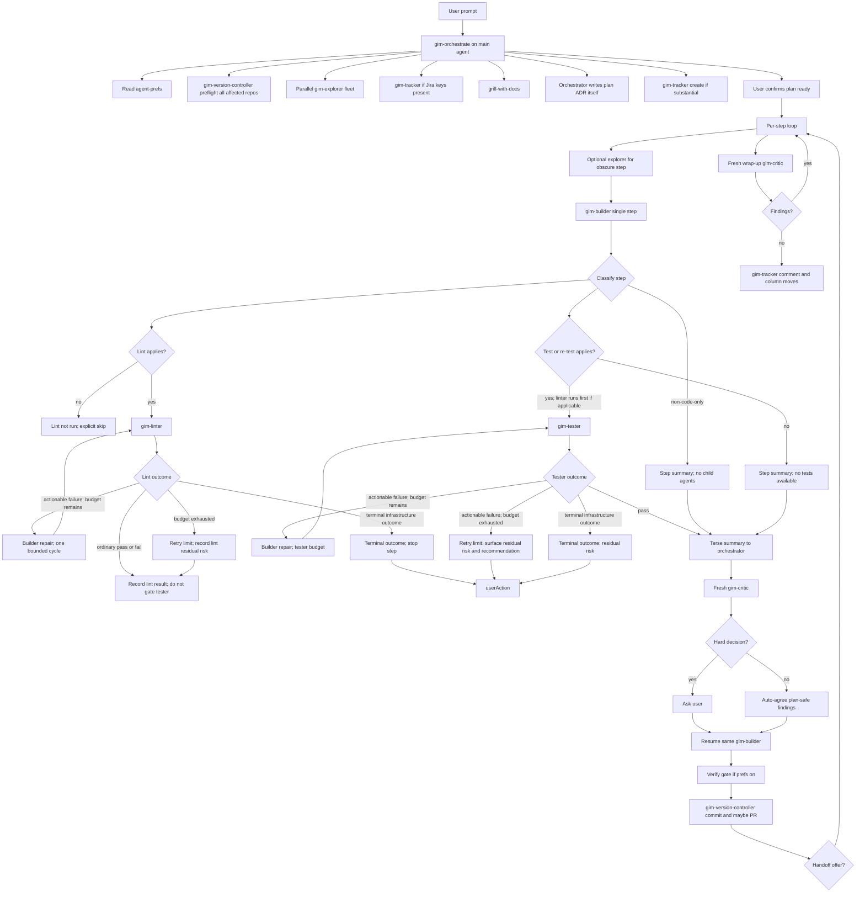

# GIM Orchestrator Fleet (Cursor) — Full Handoff Plan

> **Executor notice:** You did **not** participate in the design conversation. Treat this document as the sole source of truth. Do not re-grill locked decisions. Do not invent conflicting branch/nesting rules. If something is ambiguous *inside* this plan, ask the user once; otherwise implement as written.
>
> **Repo root for this work:** `d:\Work\GIM\GIMtransfer` (Windows / PowerShell). Sibling repos may be referenced but almost all artifacts land in GIMtransfer.
>
> **Official Cursor constraint reference:** https://cursor.com/docs/subagents.md (nesting limit, frontmatter, models, resume).

---

## Suggested skills for the executing agent

Load and follow these before/while executing:

1. [`GIMtransfer/.agents/skills/agentic-planning/SKILL.md`](d:/Work/GIM/GIMtransfer/.agents/skills/agentic-planning/SKILL.md) — honor this plan’s Execution mode section.
2. [`GIMtransfer/.agents/skills/review-with-critic/SKILL.md`](d:/Work/GIM/GIMtransfer/.agents/skills/review-with-critic/SKILL.md) — granular critic between steps + wrap-up.
3. [`GIMtransfer/.agents/skills/git-branching-workflow/SKILL.md`](d:/Work/GIM/GIMtransfer/.agents/skills/git-branching-workflow/SKILL.md) — but apply the **new** leaf-safe rules from this plan even before step C1 lands (when creating the working branch for *this* meta-plan).
4. [`GIMtransfer/.agents/skills/github-cli-workflow/SKILL.md`](d:/Work/GIM/GIMtransfer/.agents/skills/github-cli-workflow/SKILL.md) — for the **end-of-plan** single PR only.
5. [`GIMtransfer/.agents/skills/caveman/SKILL.md`](d:/Work/GIM/GIMtransfer/.agents/skills/caveman/SKILL.md) — optional for your own replies; **mandatory** to encode into every new subagent definition.
6. [`GIMtransfer/.agents/skills/domain-modeling/SKILL.md`](d:/Work/GIM/GIMtransfer/.agents/skills/domain-modeling/SKILL.md) + [`CONTEXT-FORMAT.md`](d:/Work/GIM/GIMtransfer/.agents/skills/domain-modeling/CONTEXT-FORMAT.md) + [`ADR-FORMAT.md`](d:/Work/GIM/GIMtransfer/.agents/skills/domain-modeling/ADR-FORMAT.md) — for step A1.
7. [`GIMtransfer/.agents/prompts/build-plan-with-steps.md`](d:/Work/GIM/GIMtransfer/.agents/prompts/build-plan-with-steps.md) — stern failure protocol to derive into builder handoff prompt (E2) and builder agent (D2).
8. Existing critic body to preserve on rename: [`GIMtransfer/.cursor/agents/critic.md`](d:/Work/GIM/GIMtransfer/.cursor/agents/critic.md).

---

## Execution mode (THIS meta-plan — building the fleet)

These gates apply to **you**, the agent implementing this plan — distinct from the **product defaults** the orchestrator will later read from `agent-prefs` (see below).

- [x] Verify per step
- [x] Commit per step
- [ ] PR per step — **forbidden mid-plan**. Open **one PR at the end** after F1 (+ optional Z1 wrap-up fixes).
- [x] Critic per step (`/review-with-critic granular`)

Between steps, order is: **repo-state checks → critic → verify with user → commit**. Do not open a PR until the plan is complete.

### Failure scenarios (THIS meta-plan)

Any of these = full implementation failure; stop and surface to user:

- Move to step N+1 while repo/docs are inconsistent or broken after step N.
- Skip verify with user after step N.
- Commit before verify, or commit before critic.
- Skip per-step critic.
- Skip per-step commit.
- Open a mid-plan PR.
- Re-litigate locked design decisions without user asking.
- Use Linux shell chaining (`&&`, `||`) on Windows — use PowerShell (`;`, separate commands, or PowerShell idioms).
- Create invalid git refs like `feature/foo/a1-…` (leaf/folder conflict).

### First-commit confirmation (once)

Before the first commit of this plan, confirm with the user:

- Branch name (suggest `feature/gim-orchestrator-fleet` from `dev`, all lowercase).
- Push? Default for commit-per-step without PR-per-step: **local commits only** until final PR.
- Excludes: never commit `.agents/agent-prefs.md` if created locally.

Refuse to commit on `dev`, `main`, or `release/*`.

### After final step

1. Wrap-up critic with full file list + `Steps implemented: A1, A2, B1, C1, C2, C3, D1, D2, D3, E1, E2, F1`.
2. If actionable findings → extra step `Z1` (fix + verify + commit), then include in the single PR.
3. Push branch and open **one** PR → `dev` (or user-chosen base).

---

## Why this exists (problem statement)

Today, contributors manually append many skills to every prompt (`grill-with-docs`, `agentic-planning`, `review-with-critic`, etc.). That is tedious, inconsistent, and error-prone (humans forget skills/modes).

**Goal:** A full agentic loop invoked via `/gim-orchestrate` (skill) that automatically includes the right skills/modes, keeps the main context thin by delegating to specialist subagents, and never does research/implementation/git/jira itself unless the user explicitly asks the orchestrator to do so.

**Platform:** Cursor first. OpenCode is a **separate future plan** (likely duplicate agent files; custom agent defs are not standardized).

---

## Two layers — do not confuse them

| Layer | What | PR default | Verify |
|---|---|---|---|
| **This meta-plan** (you building the fleet) | Commits of agent/skill/docs files | One PR at end | Mandatory per step |
| **Product orchestrator** (what you are building) | How `/gim-orchestrate` runs user feature work later | Prefs default `pr_per_step: true` | Prefs `verify_per_step` (default true; toggleable) |

---

## Locked design decisions (from grilling — DO NOT REOPEN)

### Q1 — Nesting / orchestrator shape

- Cursor allows only **2 levels** of subagent nesting: main → child → grandchild. Grandchildren cannot spawn further agents. Source: https://cursor.com/docs/subagents.md
- **`gim-orchestrate` is a skill that runs IN the main agent**, not a Task-spawned nested orchestrator.
- Also create [`.cursor/agents/gim-orchestrator.md`](d:/Work/GIM/GIMtransfer/.cursor/agents/gim-orchestrator.md) **for form** (model pin, selectable agent definition), with body mirroring the skill.
- Builder (depth 1) **may** spawn linter/tester (depth 2).
- Orchestrator **owns** critic spawn. Builder **never** spawns critic.
- Document this nesting rule in every agent file.

### Q2 — Branch / PR topology (product behavior)

- Topology **A**: docs-first base feature branch + chained step branches/PRs (product default when `pr_per_step: true`).
- **Critical git rule:** a ref cannot be both a leaf and a folder. Therefore:

```text
CORRECT:
  feature/foo-bar                 ← base feature branch
  foo-bar/a1-add-foo              ← step branch (NOT under feature/)
  foo-bar/a2-add-bar
  foo-bar/b1-combine-foo-bar

WRONG (will break):
  feature/foo-bar/a1-add-foo
```

- All branch names **lowercase**.
- With Jira: `feature/gim-01234-add-foobar` then `gim-01234-add-foobar/a1-…`.
- Existing skill already warns about prefix issues; harden it in step C1 so agents stop inventing invalid names.

### Q3 — Docs commits on `feature/*`

- Exception to “never commit on base feature branch”: **only relevant feature documents** (plan, ADR, RFC, thin pointer plans, similar).
- Implementation code never lands directly on `feature/*`; only via step-branch PRs (product) / step commits (depending on prefs).

### Q4 — Prefs location

- **GIMtransfer only:**
  - Committed: `.agents/agent-prefs.template.md`
  - Gitignored: `.agents/agent-prefs.md`
- Users load the full multi-root workspace; no per-repo prefs copies.

### Q5 — Critic rename

- **Hard rename** `critic` → `gim-critic`.
- Update all references. **No compat shim.**
- Canonical file: `.cursor/agents/gim-critic.md`
- Pointer: `.agents/agents/gim-critic.md` → one line pointing at canonical.
- Delete `.cursor/agents/critic.md` and `.agents/agents/critic.md`.

### Q6 — Jira auto-create thresholds (product)

Auto-create (via `gim-tracker` / acli) when **any** of:

1. Plan has ≥3 implementation steps, or
2. Touches ≥2 repos, or
3. User tagged an epic/parent but no child ticket, or
4. User explicitly asks to file a ticket

Skip for docs-only, single-file nits, `.agents`/`.cursor` meta unless asked. Always confirm project + summary before create. If ticket key already in prompt, reuse — never duplicate.

### Q7 — Builder resume + critic freshness

- Store `builder_agent_id` per step.
- Critic-fix pass: **resume** same builder with agreed findings only.
- If resume fails: one fresh spawn with full step context + warn user.
- Builder never spawns critic; orchestrator reports critic findings **to** the builder via resume prompt.
- **Every critic run is fresh** (never resume critic — avoids bias).
- Prefs: `critic_reruns_per_step: one` (default) or `until_clean` (iterate while findings remain that aren’t intentionally ignored).

### Q8 — Agent file dual home

- **Canonical:** `.cursor/agents/gim-*.md` (Cursor format + YAML frontmatter).
- **Pointers:** `.agents/agents/gim-*.md` containing exactly one line like: `See .cursor/agents/gim-builder.md (canonical).`
- OpenCode later: likely full duplicates (out of scope).

### Q9 — Plan file home (product)

- Full plan: `<primary-impact-repo>/docs/plans/NNNN-slug.plan.md`
- Prefer **GIMtransfer** when impact is even / workspace-hub work.
- Sibling repos with **substantial** changes get a **thin pointer plan** that links to the main plan (same NNNN where possible).
- Example: new map type spanning GIMmap + format work → main plan in GIMtransfer; thin plans in CoreWebApi and GIMfront pointing at it.

### Q10 — Verify gate (product) — prefs-toggleable

`verify_per_step` defaults to **true** but is a real gate: if set **false**, the orchestrator may continue without stopping for user confirmation (blast-through allowed by choice).

When `verify_per_step` is true, after step N (builder and any applicable scoped validation done; critic run; agreed fixes applied):

Orchestrator stops and shows:

1. List of files touched
2. Critic disposition (what was found, what was fixed, what was ignored and why)
3. Test recipe when validation applies, otherwise “not testable — inspect files”

Continue only on affirmatives: `looks good`, `verified`, or similar.

**Critic↔user mid-loop:** ask the user only for **hard/ambiguous** decisions. Otherwise orchestrator auto-decides (fix all plan-safe correct findings including nitpicks) and surfaces the disposition at the verify gate (when verify is on).

### Q11 — Handoff offer cadence (product)

Offer handoff when:

- **3 steps in a row** completed without a handoff offer, or
- A step whose **diff exceeds 1000 lines**

Exact user-facing gist (encode in orchestrator skill):

> I cannot see my own context usage; and thus it's important to pause here to ask you whether you wish to continue implementation, or you wish to invoke the `@GIMtransfer/.agents/skills/handoff/SKILL.md` skill to handoff to another agent.

### Q12 — Preflight sync (product, via version-controller)

For **all affected repos**:

1. `git status` first
2. If dirty → STOP, report, ask user (never stash/reset/force)
3. If clean → `git fetch` → `git checkout <dev-or-user-named-start>` → `git pull --ff-only`
4. If not ff-only / conflicts → STOP, ask

Exception: user explicitly starts from a named branch for chained work.

### Q13 — Missing prefs

- If `.agents/agent-prefs.md` missing → copy from template locally, announce defaults, continue.
- Never commit the copied prefs file.
- If template missing → hard stop (repo incomplete).

### Q14 — Wrap-up critic findings

- Fresh full-plan critic at end.
- If actionable findings → append real plan step (e.g. `Z1`), run **full** per-step loop (builder-owned applicability → bounded linter/tester gates → fresh critic → hard-decision asks → mandatory verify → commit/PR per prefs).
- If nothing actionable → no empty step.

### Additional locked product rules (from original brief)

- Orchestrator **never does its own work** unless user explicitly asks; delegates everything delegable.
- Orchestrator **writes** plans/ADRs/RFCs/top-level docs itself (not via builder).
- Builder implements the step and adds or updates tests when changed code and relevant test scope exist; does not run tests.
- Plan steps: update pending → completed in the tracked plan file; notes allowed (“went with foo instead of bar”).
- Plan + ADR committed on first `feature/<name>` branch; PR against `dev` (or chosen base) for docs.
- Pushback allowed on fundamentally broken / anti-GIM architecture requests.
- All subagents: caveman **full** + terse parent reports.
- Skill loading is non-deterministic in agent defs → **stern instructions** in each agent body to Read/load listed skills.
- Models: orchestrator agent file `grok-4-5[fast=false]`; all other agents `composer-2.5[fast=false]` (not fast mode).
- Debugger instrumentation server: **not built now** — skeleton only.
- Harness footer: `__this action was performed by <harness> automatically__`; **detect** harness at runtime (not a prefs key — same person may use multiple harnesses); **default `opencode` if undetectable**.
- Version-controller: always assign PRs to `@me`; write PR body to repo-root `.pr-body.md` then `gh pr create --body-file …` then delete the file; prefer `gh pr-review` extension over `gh api`.
- C# linting: linter **ignores** C# until further notice.
- Frontend: no real test suite; small smoke validation is optional when applicable and useful.
- Missing C# test projects: skip or escalate validation according to the specialist contract; do not invent a test framework.

---

## Product orchestrator workflow (encode verbatim into skill + agent)

This is what `/gim-orchestrate` must perform. The meta-plan executor is **creating the docs that describe this**, not running this loop for a CAD feature.



### Numbered product loop (0–16)

0. Read `.agents/agent-prefs.md` (copy from template if missing). Verify repo state via version-controller preflight (status → clean → fetch → checkout → ff-only) for all affected repos.
1. User presents goal / prompt list.
2. Spawn **gim-explorer** fleet in parallel (readonly). Do not research in the main agent. If Jira keys mentioned → **gim-tracker** fetch (full ticket text, not summarized).
3. Grill via `grill-with-docs` (which runs grilling + domain-modeling).
4. After decisions lock, author plan per `agentic-planning` into primary repo `docs/plans/NNNN-….plan.md`; write ADRs as needed; thin pointer plans in siblings if substantial.
5. Confirm with user: plan ready or more tweaks?
6. If substantial per Jira thresholds → create ticket (confirm first). Ensure branch names include ticket key.
7. Begin implementation **one step at a time**. Optionally spawn explorer for obscure step context first.
8. Hand off **single step** to **gim-builder** using stern handoff prompt (critical failure language like `build-plan-with-steps.md`). Builder implements, adding or updating tests when changed code and relevant test scope exist; **does not** run them; **does not** solution-build. Builder independently decides and records linter/tester applicability, then passes bounded scope.
9. When lint applies, builder spawns **gim-linter** with exact files only. Linter owns lint **and** format; fixes simple issues; reports complex or terminal outcomes. When lint does not apply, builder records explicit linter skip. Non-code-only steps spawn neither child.
10. Independently, when bounded test context applies, builder spawns **gim-tester**; when both apply, tester follows linter for ordering, but no linter result gates tester applicability and ordinary lint failure does not suppress tester. Tester returns terse summary with verbatim failure detail. Linter and tester retries use separate budgets; terminal outcomes stop retries, escalate exact result and recommendation to the user, and leave residual risk.
11. Orchestrator spawns **fresh gim-critic** (never builder-spawned; never resumed critic).
12. Critic returns findings to orchestrator.
13. Orchestrator disposition: hard calls → ask user; else auto-apply plan-safe agrees including nitpicks. Resume **same** builder with fix instructions. (Respect `critic_reruns_per_step`.)
14. After verify gate passes (or is skipped when `verify_per_step: false`), **gim-version-controller** stages, commits, opens PR if `pr_per_step`, creates next step branch as needed. Update plan file step status pending→completed (committed with the step).
15. Handoff offer if cadence triggers; else continue to next step (back to 7/8).
16. End: wrap-up fresh full-plan critic; optional Z-step; tracker moves columns + comment (lean toward leaving a comment, e.g. “implemented as described, waiting review…”).

**Verify gate** sits after critic fixes and **before** version-controller commit when `verify_per_step: true` (aligns with agentic-planning: critic → verify → commit → PR). When false, skip straight to version-controller.

### Embedded alternate flow: gim-debugger

Invoke at start if user wants a bugfix, or if implementation hits a bug that cannot be fixed by code alone without diagnosis:

1. Orchestrator delegates to debugger.
2. Debugger would spawn debug server — **TO-COME; not implemented in v0**.
3. Create 3–5 hypotheses.
4. Add instrumentation pointing at debug server — **TO-COME**; v0 must state this and fall back to diagnosing-bugs skill practices without the server.
5. Ask user to reproduce; provide steps.
6. After repro confirmed, check logs / evidence; verify which hypotheses hold.
7. Fix bug; leave instrumentation (when it exists).
8. Ask user to re-run happy path.
9. If still broken → back to hypotheses/instrumentation.
10. If fixed → strip instrumentation; report to orchestrator.

v0 agent file: skeleton of this flow + “instrumentation deferred” banner + load `diagnosing-bugs`.

---

## Glossary terms (bake into `.agents/CONTEXT.md` in A1)

Create [`.agents/CONTEXT.md`](d:/Work/GIM/GIMtransfer/.agents/CONTEXT.md) (agent-fleet context — **not** CAD `GimData` language).

Suggested entries (tighten wording on write; keep definitions 1–2 sentences; use `_Avoid_`):

- **Orchestrator** — Main-loop agent/skill that sequences the fleet and never performs research/implementation/git/jira itself unless the user explicitly asks. _Avoid_: coordinator, manager agent (ambiguous).
- **Explorer** — Readonly research subagent that searches the workspace/web and returns findings. _Avoid_: searcher.
- **Builder** — Subagent that implements exactly one plan step, adds or updates tests when applicable, and may spawn linter/tester. _Avoid_: implementer, coder.
- **Linter** — Subagent that owns scoped lint and format for touched files and applies only safe simple fixes. _Avoid_: formatter (as a separate role — Linter does both).
- **Tester** — Subagent that validates changed code when relevant test context exists and reports explicit skips or escalations otherwise. _Avoid_: QA agent.
- **Critic** (`gim-critic`) — Readonly post-step reviewer; always fresh; never modifies the repo. _Avoid_: reviewer (too generic), old name `critic` alone in new docs.
- **VersionController** — Subagent that owns git and GitHub CLI mutations under a destructive deny-list. _Avoid_: git agent.
- **Tracker** — Subagent that owns Jira via acli. _Avoid_: jira agent.
- **Debugger** — Subagent for hypothesis-driven bug diagnosis; instrumentation server deferred. _Avoid_: fixer.
- **VerifyGate** — Prefs-gated user confirmation after a step, with files + disposition + test recipe (when `verify_per_step: true`). _Avoid_: approval (ambiguous with GitHub).
- **ThinPlan** — Pointer plan file in a sibling repo that references the primary plan. _Avoid_: stub plan (unclear).
- **FeatureDocuments** — Plan/ADR/RFC/thin-plan docs allowed on `feature/*` under the docs-only exception. _Avoid_: “docs” alone.
- **LeafSafeBranch** — Branch naming that never creates `feature/<name>/<step>` under an existing `feature/<name>` leaf.
- **Prefs** — Local gitignored `agent-prefs.md` controlling gates/architecture. _Avoid_: settings.json (Cursor IDE settings).

---

## ADR content outlines (A1)

### `docs/adr/agents/0001-AGENTS-cursor-orchestrator-nesting.md`

Record: Cursor nesting depth 2 → orchestrator must be skill-on-main (plus agent def for form), not a nested Task orchestrator; builder may spawn linter/tester; critic owned by orchestrator. Alternatives rejected: fully flat spawn-only-from-main; nested orchestrator subagent.

### `docs/branching-strategy.md`

Record: git refs cannot be leaf and folder; step branches are `<name>/<stepid>-<title>`; docs-only exception on `feature/*`; all lowercase; Jira key embedding. Alternatives rejected: `feature/<name>/<step>` nesting.

---

## Prefs template contents (B1) — required keys

File: `.agents/agent-prefs.template.md`

Must document at least:

```markdown
# GIM agent prefs (template)
# Copy to agent-prefs.md (gitignored) and edit.

## Gates
- verify_per_step: true
  # When false, orchestrator may continue without a per-step user verify gate.
- commit_per_step: true
- pr_per_step: true
- critic_per_step: granular   # off | end | granular
- critic_reruns_per_step: one # one | until_clean

## Runtime
- architecture: windows      # windows => PowerShell; linux => bash
- default_dev_branch: dev
```

Also add `.gitignore` entry: `.agents/agent-prefs.md`

Harness is **not** a prefs key (detect at runtime; default `opencode` if unknown). `start_branch` is **not** a prefs key (chosen per run / prompt).

---

## Agent inventory (end state)

### Canonical (Cursor loads these)

| File | name | model | readonly | Spawns |
|---|---|---|---|---|
| `.cursor/agents/gim-orchestrator.md` | gim-orchestrator | `grok-4-5[fast=false]` | false | explorers, tracker, builder, critic, version-controller, debugger (via Task); does not implement |
| `.cursor/agents/gim-explorer.md` | gim-explorer | `composer-2.5[fast=false]` | **true** | none required |
| `.cursor/agents/gim-builder.md` | gim-builder | `composer-2.5[fast=false]` | false | conditional linter/tester only |
| `.cursor/agents/gim-linter.md` | gim-linter | `composer-2.5[fast=false]` | false | none |
| `.cursor/agents/gim-tester.md` | gim-tester | `composer-2.5[fast=false]` | false | none |
| `.cursor/agents/gim-critic.md` | gim-critic | `composer-2.5[fast=false]` | **true** | none |
| `.cursor/agents/gim-version-controller.md` | gim-version-controller | `composer-2.5[fast=false]` | false | none |
| `.cursor/agents/gim-tracker.md` | gim-tracker | `composer-2.5[fast=false]` | false | none |
| `.cursor/agents/gim-debugger.md` | gim-debugger | `composer-2.5[fast=false]` | false | none (server to-come) |

### Pointers

Each canonical agent has `.agents/agents/<same-name>.md` with one-line pointer.

### Skills / prompts

| Path | Role |
|---|---|
| `.agents/skills/gim-orchestrate/SKILL.md` | Primary invocation `/gim-orchestrate` |
| `.agents/prompts/orchestrator-step-brief.md` | Stern single-step builder brief |
| Updated git-branching, github-cli, review-with-critic | Contracts |

---

## Per-agent contract details (encode into agent markdown bodies)

### Global requirements for EVERY subagent body

1. Stern first section: **Read and obey** listed skill paths (skill loading is non-deterministic — do not rely on auto-attach).
2. Stern: invoke / behave under **caveman full** for all reports back to parent; minimize parent context pollution.
3. State Cursor nesting rule and what this agent may/may not spawn.
4. State OS: read architecture from prefs if provided in prompt; default Windows PowerShell.
5. Output contract: terse structured summary (specify fields per agent).

### gim-explorer

- Readonly.
- Tools mindset: Grep, Glob, Read, semble via `workspace-code-search` (`uv run` from GIMtransfer), WebSearch/WebFetch when repo insufficient or instructed.
- Skills: caveman; workspace-code-search; then conditionally:
  - GIMtransfer CAD: `general-gimdata-skill`, `fileaccess-routing`, `format-adapter-contract`, `gimtransfer-json-versioning`
  - CoreWebApi: `corewebapi-data-access`, `corewebapi-layered-feature`, `stored-procedure-assessment` if SP-related
  - GIMfront: `gimfront-tech-debt`, `gimfront-state-data`, `gimfront-desktop-web-apis`, `gimfront-3d-viewer` as relevant
  - GIMmanager: `gimmanager-tech-debt`
  - GIMzip: `gimbin-skill`
- Return: bullet findings with file paths; no essays.

### gim-builder

- Implements **one** plan step only.
- Must follow handoff prompt failure scenarios (critical failure if skips gates that apply to it — builder itself doesn’t verify-with-user; orchestrator does).
- Writes/updates unit tests when changed code and relevant test scope exist; **does not run** them.
- Does not `dotnet build` / `npm run build` solution-wide; may use ReadLints / IDE diagnostics.
- After edits: decide linter and tester applicability independently, spawn each only with its exact bounded inputs, and allow tester to run without a linter result when its own test context applies. When both apply, run linter first for ordering; allow one repair cycle and no more than two invocations per child, with separate retry budgets. Terminal outcomes stop retries and escalate exact result plus recommendation to the user.
- Never spawn gim-critic.
- Load area skills same as explorer for the repos touched.

### gim-linter

- Owns **lint and format** for the step (one agent, both jobs — no separate formatter).
- Lint/format **only touched files** / area commands from that repo’s AGENTS.md.
- Never repo-wide `npm run lint` / format unless explicitly instructed.
- C#: ignore lint/format until further notice (record in agent body).
- Simple mechanical fixes OK; behavior-risky lints → report to builder, do not “clever fix”.

### gim-tester

- Build changed code and run relevant tests when changed code and relevant test scope exist.
- If no relevant test context exists, explicitly skip validation; escalate according to the specialist contract when validation is blocked.
- Frontend: no suite; minimal smoke is optional when applicable and useful.
- Report: `passed=N failed=M` + failing names + error excerpts (terse).

### gim-critic

- Preserve existing critic contract from current `.cursor/agents/critic.md` (categories, severities, reading strategy, output format).
- Rename identity to gim-critic; update description triggers to `/gim-critic`.
- Add stern caveman full for output (already terse).
- Readonly unchanged.

### gim-version-controller

- Owns: status/fetch/checkout/ff-only pull, branch create, stage, commit, push, `gh pr create/edit/comment`, fetch review comments via **gh pr-review** first.
- PR body: write repo-root `.pr-body.md` → `--body-file` → delete the file (no shell here-strings).
- Assign PR to `@me`.
- Footer via runtime harness detection (generic template; default `opencode` if unknown — not a prefs key).
- **Deny-list (no consent → refuse):**
  - `git reset --hard` (any)
  - `git push --force` / `--force-with-lease` / `-f`
  - `git rebase` (any)
  - `git branch -D` / forceful branch delete
  - `git clean` removing untracked
  - `git checkout -- <file>` discarding unstaged changes
  - `git commit --amend` on pushed commits
  - `gh pr merge` / `close` / `revert`
  - `gh pr ready`
  - `gh pr edit --base`
  - `gh auth logout` / `refresh` / `token`
  - `gh extension install` / `upgrade` / `remove`
  - `gh api` unless last resort after pr-review cannot
- Skills: git-branching-workflow, github-cli-workflow, caveman.

### gim-tracker

- acli only for Jira.
- Never delete tickets unless user explicitly asks.
- Fetch: return ticket bodies **full as-is**.
- Other actions: terse confirmations.
- Skill: atlassian-jira-cli, caveman.

### gim-debugger

- v0 skeleton of the 10-step flow above.
- Banner: instrumentation/debug-server **not implemented**; do not pretend.
- Skill: diagnosing-bugs, caveman.

### gim-orchestrator (agent file) + gim-orchestrate (skill)

Skill is the real entrypoint; agent file mirrors for form/model.

Must load/read:

- agent-prefs (path above)
- agentic-planning
- grill-with-docs (+ grilling/domain-modeling as that skill directs)
- caveman
- review-with-critic
- handoff (when offering)
- build-plan-with-steps / orchestrator-step-brief
- WORKSPACE.md when multi-repo

Must encode full loop 0–16, verify gate text, handoff cadence text, Jira thresholds, plan paths, branch rules, pushback duty, “never do the work”, nesting rules, resume-builder rules, wrap-up Z-step behavior.

---

## GitHub footer migration (C2) — exact intent

Replace:

```text
__this action was performed by cursor automatically__
```

With:

```text
__this action was performed by <harness> automatically__
```

Where `<harness>` comes from **runtime detection** (not prefs — same user may switch harnesses); if unknown, use `opencode`.

Update SKILL.md + all references under `.agents/skills/github-cli-workflow/references/` that hardcode the old footer. Title/commit messages still get **no** footer (existing rule).

Also document: when writing PR bodies, write a repo-root file (e.g. `.pr-body.md`), run `gh pr create --body-file` / `gh pr edit --body-file`, then delete the file — no embedded shell here-strings (version-controller and any agent following github-cli-workflow).

---

## AGENTS.md setup section (A2) — required topics

Add a section such as “GIM agentic loop setup” covering:

1. Use the multi-root workspace (`GIMtransfer.code-workspace`).
2. Copy `.agents/agent-prefs.template.md` → `.agents/agent-prefs.md` (gitignored).
3. Install GitHub CLI — point to `.agents/skills/github-cli-workflow/scripts/install_gh.py` / skill docs.
4. Install Atlassian acli — point to `.agents/skills/atlassian-jira-cli/`.
5. Invoke `/gim-orchestrate` instead of manually appending skill bundles.
6. Link roster of gim-* agents, CONTEXT, ADRs, prefs, docs/plans.

---

## Implementation steps (execute in order)

### Step A1 — Glossary + ADRs + dirs [critic, verify]

- **Files / symbols**: `.agents/CONTEXT.md`; `docs/adr/agents/0001-AGENTS-cursor-orchestrator-nesting.md`; `docs/branching-strategy.md`; `docs/plans/` directory; `docs/plans/agents/0001-AGENTS-gim-orchestrator-fleet.plan.md` (copy of **this** full plan body, suitable for in-repo tracking).
- **Change**: Create glossary + two ADRs + plans home; persist this handoff plan into the repo path so later executors/PRs can see it.
- **Why**: Domain language + irreversible decisions recorded before agent files proliferate.
- **Validate**: Paths exist; ADR numbers unique; plan copy present.
- **Commit message**: `A1: add agent-fleet glossary, ADRs, and plans home`

### Step A2 — AGENTS setup section [critic, verify]

- **Files**: `AGENTS.md`
- **Change**: Add setup section as specified above; add skill index entries for `gim-orchestrate` when it exists (can stub link and complete in F1 if skill not yet present — prefer complete links in F1 if missing).
- **Validate**: Links that already exist resolve; no broken mandatory paths.
- **Commit message**: `A2: document gim orchestrator setup in AGENTS.md`

### Step B1 — Prefs template + gitignore [critic, verify]

- **Files**: `.agents/agent-prefs.template.md`; `.gitignore`
- **Change**: Full template keys; gitignore `.agents/agent-prefs.md`.
- **Validate**: Template has required gate/runtime keys; `verify_per_step` is toggleable (no never-skip note); no `harness` / `start_branch` prefs keys; gitignore entry present.
- **Commit message**: `B1: add agent-prefs template and gitignore`

### Step C1 — Branching skill [critic, verify]

- **Files**: `.agents/skills/git-branching-workflow/SKILL.md` (+ references if any examples exist)
- **Change**: Lowercase rule; leaf-safe examples (correct vs wrong); step id pattern `<name>/<stepid>-<title>`; docs-only feature branch exception; Jira examples.
- **Validate**: No example shows `feature/<name>/<step>`.
- **Commit message**: `C1: harden leaf-safe branch naming and docs exception`

### Step C2 — GitHub CLI harness footer [critic, verify]

- **Files**: `.agents/skills/github-cli-workflow/SKILL.md`; `references/pr-description-template.md`; `references/reviewing-pr-feedback.md`; `references/gh-commands.md`; `references/gh-pr-review-extension.md`; any other hardcoded footer.
- **Change**: Harness-generic footer; temp-file PR body guidance for Windows; assign `@me` remains.
- **Validate**: `rg "performed by cursor automatically"` returns no required-footer hits (or only historical notes pointing to new rule).
- **Commit message**: `C2: harness-generic PR footer and temp-file PR bodies`

### Step C3 — Retarget review-with-critic [critic, verify]

- **Files**: `.agents/skills/review-with-critic/SKILL.md`; grep-driven updates elsewhere.
- **Change**: All paths → `.cursor/agents/gim-critic.md`; triggers mention `/gim-critic`.
- **Note**: May land just before or with D1; if critic file not renamed yet, C3 can reference the **target** path and D1 must create it in the same PR chain — prefer **D1 immediately after C3** in the same working session so links never 404 on `dev` mid-chain. If commit-per-step leaves a broken link between C3 and D1, that is acceptable only if D1 follows immediately and verify notes the temporary gap — **better: merge C3+D1 if coherence requires**, but plan lists them separate; executor should do C3 then D1 without publishing mid-plan PR (already the case).
- **Commit message**: `C3: retarget review-with-critic to gim-critic`

### Step D1 — Rename critic → gim-critic [critic, verify]

- **Files**: create `.cursor/agents/gim-critic.md` from current critic body; create pointer `.agents/agents/gim-critic.md`; delete old `critic.md` files both homes.
- **Change**: Hard rename; update frontmatter name/description; keep contract; add caveman stern load line.
- **Validate**: No `.cursor/agents/critic.md`; Task description resolves gim-critic.
- **Commit message**: `D1: rename critic agent to gim-critic`

### Step D2 — explorer, builder, linter, tester [critic, verify]

- **Files**: `.cursor/agents/gim-explorer.md`, `gim-builder.md`, `gim-linter.md`, `gim-tester.md` + four pointers.
- **Change**: Full contracts from “Per-agent contract details”.
- **Validate**: models pinned; readonly on explorer; builder documents spawn permissions.
- **Commit message**: `D2: add explorer builder linter tester agents`

### Step D3 — version-controller, tracker, debugger [critic, verify]

- **Files**: `.cursor/agents/gim-version-controller.md`, `gim-tracker.md`, `gim-debugger.md` + pointers.
- **Change**: Full contracts; deny-list; debugger deferred banner.
- **Validate**: deny-list present; debugger states instrumentation to-come.
- **Commit message**: `D3: add version-controller tracker debugger agents`

### Step E1 — gim-orchestrate skill + orchestrator agent [critic, verify]

- **Files**: `.agents/skills/gim-orchestrate/SKILL.md`; `.cursor/agents/gim-orchestrator.md`; `.agents/agents/gim-orchestrator.md` pointer.
- **Change**: Encode entire product loop, gates, prefs read, pushback, nesting, verify text, handoff text, Jira rules, plan path rules, thin plans, wrap-up Z-step, tracker closeout. Skill description must encourage `/gim-orchestrate` / proactive use for multi-step GIM work.
- **Validate**: model `grok-4-5[fast=false]` on agent file; skill has YAML frontmatter name/description per repo skill conventions.
- **Commit message**: `E1: add gim-orchestrate skill and orchestrator agent`

### Step E2 — Step brief prompt [critic, verify]

- **Files**: `.agents/prompts/orchestrator-step-brief.md`
- **Change**: Template parameters: plan path, step id, step section excerpt, prefs gate summary, architecture, files/symbols hint, critical failure scenarios (adapted from build-plan-with-steps), instruction to load caveman full, instruction to decide linter and tester applicability independently (with linter first when both apply), forbid spawning critic, forbid repo-wide lint, forbid running tests itself. Name is **brief** (not handoff) to avoid clash with `.agents/skills/handoff/` session compaction.
- **Validate**: Referenced from gim-orchestrate skill and gim-orchestrator agent.
- **Commit message**: `E2: add orchestrator-to-builder step brief prompt`

### Step F1 — Inventory + cross-links [critic, verify]

- **Files**: `AGENTS.md` skill list; `WORKSPACE.md` short pointer if appropriate; ensure every `.cursor/agents/gim-*.md` has pointer; fix any stale `critic` references in active skills/prompts/AGENTS (not ancient RFC history unless needed).
- **Change**: Consistency pass; note OpenCode port out of scope.
- **Validate**: `Get-ChildItem .cursor/agents/gim-*.md` matches pointer set; `rg` for `.cursor/agents/critic` clean.
- **Commit message**: `F1: finalize agent inventory and cross-links`

### Step Z1 — Wrap-up critic coherence [critic, verify]

- **Files**: `.agents/skills/github-cli-workflow/SKILL.md`; `.agents/prompts/build-plan-with-steps.md`; `.agents/skills/agentic-planning/SKILL.md`; `.agents/skills/gim-orchestrate/SKILL.md`; `.agents/prompts/orchestrator-step-brief.md`; `.cursor/agents/gim-builder.md`; `.agents/skills/review-with-critic/SKILL.md`; `.agents/CONTEXT.md`.
- **Change**: Propagate C1 leaf-safe + lowercase branch examples into github-cli and build-plan-with-steps; pin Task `subagent_type: gim-*` in orchestrate/brief/builder/review-with-critic; replace leftover “critic subagent” wording with `gim-critic`; fix “SKILL body” → agent output contract; note explorer `is_background: true` in CONTEXT.
- **Validate**: `rg` for `<feature>/<stepId>` and `seam-edges/A1` clean in active skills/prompts; spawn docs mention `subagent_type`.
- **Commit message**: `Z1: fix wrap-up critic coherence gaps`

---

## Expected end-state file tree (GIMtransfer)

```text
.agents/
  CONTEXT.md
  agent-prefs.template.md
  agent-prefs.md          # gitignored; may exist locally only
  agents/
    gim-orchestrator.md   # pointer
    gim-explorer.md
    gim-builder.md
    gim-linter.md
    gim-tester.md
    gim-critic.md
    gim-version-controller.md
    gim-tracker.md
    gim-debugger.md
  skills/
    gim-orchestrate/SKILL.md
    git-branching-workflow/SKILL.md   # updated
    github-cli-workflow/…             # updated
    review-with-critic/SKILL.md       # updated
  prompts/
    orchestrator-step-brief.md
    build-plan-with-steps.md          # unchanged source of sternness
.cursor/agents/
  gim-orchestrator.md
  gim-explorer.md
  gim-builder.md
  gim-linter.md
  gim-tester.md
  gim-critic.md
  gim-version-controller.md
  gim-tracker.md
  gim-debugger.md
  # critic.md REMOVED
docs/
  adr/
    agents/
      0000-AGENTS-INDEX.md
      0001-AGENTS-cursor-orchestrator-nesting.md
  branching-strategy.md
  plans/
    agents/
      0001-AGENTS-gim-orchestrator-fleet.plan.md
AGENTS.md                             # setup section added
.gitignore                            # agent-prefs.md ignored
```

---

## Out of scope

- OpenCode agent port / duplicate defs.
- Debugger instrumentation server implementation.
- Adding dotnet formatters / ESLint policy changes beyond documenting linter behavior.
- Creating a real GIMfront test framework.
- Changing product default `pr_per_step` away from true.
- Executing the product orchestrator loop for an unrelated CAD feature as part of this plan.

---

## Review

After execution, run `/review-with-critic granular` once more after the last per-step critic pass, with the **full** modified file list and `Steps implemented: A1, A2, B1, C1, C2, C3, D1, D2, D3, E1, E2, F1` (plus `Z1` if used). Wrap-up weights cross-step coherence (e.g. skill references agent path that was renamed later; pointer missing; footer updated in SKILL but not references).

---

## Conversation provenance (for humans)

- Designed via `/grill-with-docs` + domain-modeling in Cursor plan mode.
- User locked decisions Q1–Q14 as summarized above.
- User requested this plan be explicit/verbose because **other agents** will execute it; handoff content is baked in rather than a separate temp handoff file.
