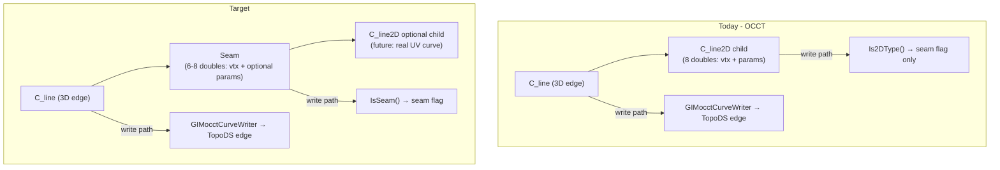

# Handoff: Implement `Seam` GimElement Type

**Repo:** `GIMmos` (+ coordinated changes in proprietary GimBin with maintainers who have source access)  
**Goal:** Replace misuse of `C_line2D` as a seam marker with a dedicated `Seam` element type; migrate old GIMbin files on read.  
**Context:** Prior analysis conversation — this document consolidates findings and agreed direction.

---

## 1. Problem statement

### Why 2D curve types exist today

`GimElementType` defines nine `C_*2D` curve types (`C_line2D` = 45, etc.) in `GIMCompress/entities/GimElement.cs`. They were designed for **p-curves** (curves embedded in a face’s UV space) and **seam edges** on closed surfaces (cylinder, sphere, …).

They diverge from their 3D counterparts:

| 3D “clean” curves (`C_line`, `C_circle`, …) | All `C_*2D` types today |
|---------------------------------------------|-------------------------|
| Placement via `GimLocal` + geometric params | **6-double prefix:** `startX/Y/Z`, `endX/Y/Z` in `elementDoubles[0..5]` |
| | Then type-specific data (params, radius, poles, …) |

Reasons for the prefix:
- Seam edges on self-intersecting/self-fusing faces — need to know **where the seam starts/ends** in 3D.
- Ambiguity whether 2D coords are world 3D vs parent UV space.

### What actually happens in production code

**`C_line2D` is the only 2D type actively created** in live import paths. It functions as **seam metadata**, not as UV geometry.

**Hierarchy today:**
```
wire
  └── C_line / C_bspline / …   (3D edge — real geometry)
        └── C_line2D           (seam annotation child)
```

---

## 2. Agreed design (implement this)

### New `Seam` element type

Add a **non-curve** `GimElementType` (e.g. `Seam = 29` or another free slot — see §5).

**Role:** Store seam anchor information; act as a **seam flag** on a 3D edge.

**Proposed payload (recommended: 8 doubles for lossless migration):**
```
elementDoubles[0..2]  startX, startY, startZ   (3D)
elementDoubles[3..5]  endX, endY, endZ         (3D)
elementDoubles[6..7]  uMin, uMax               (surface param range; optional / 0 when unknown)
```

**Minimum (6 doubles)** is acceptable if you explicitly drop param preservation; **8 doubles** preserves existing `C_line2D` bin data and supports future PCurve export.

**Hierarchy (target):**
```
C_line / C_bspline / …   (3D edge)
  └── Seam                 (metadata — NOT IsCurve, NOT Is2DType)
        └── C_line2D / C_bspline2D / …   (optional child — real UV/PCurve when needed, future work)
```

**Rules to document in `docs/specs/gimdata/README.md`:**
- A 3D curve may have **at most one** `Seam` child.
- `Seam` may have **0–1** `C_*2D` (or refactored UV curve) children for PCurve geometry.
- `Seam` is **not** a curve; exclude from `IsCurve()`, `Is2DType()`, `Is3D()` curve traversal where inappropriate.

### What happens to `C_line2D` and other `C_*2D`

- **Phase 1 (this task):** Introduce `Seam`; migrate `C_line2D` seam usages; update seam detection to use `Seam` instead of `Is2DType()`.
- **Later:** Refactor remaining `C_*2D` types to proper UV curve layouts (mirror 3D counterparts via locals + params), as children of `Seam` when needed. See `TECH_DEBT.md` TD-005 substeps (1)–(2).

**Do not change `C_line2D`’s on-disk layout** — migrate on read only (per backwards-compat rules).

---

## 3. Current `C_line2D` schema (for migration)

```csharp
C_line2D = 45
// elementDoubles: [0]startX, [1]startY, [2]startZ,
//                  [3]endX, [4]endY, [5]endZ,
//                  [6]aParamFirst, [7]aParamLast
// GetDoubleCount → 8  (EntityHelpers.cs)
```

---

## 4. Complete usage map (all touchpoints)

### 4.1 Active — must update

| File | What it does | Required change |
|------|--------------|-----------------|
| `GIMtransfer/read/GIMocctRead/GIMocctReadElements.cs` (~672–695) | On `edgeShape.IsSeam()`, creates `C_line2D` child with vtx XYZ + seam params | Create `Seam` via `SeamBuilder` instead |
| `GIMtransfer/write/GIMocctWrite/GIMocctSurfaceWriter.cs` (~264–275, 40–118) | `CreateCurves`: `Is2DType()` child → `seamInformation` bool; `SetSeamInformation`; seam edge pairing via parent 3D endpoints | Replace `Is2DType()` with `IsSeam()` / `ElementType == Seam` |
| Proprietary GimBin (private) | — | Coordinate with maintainers |
| `GIMCompress/EntityHelpers.cs` | `GetDoubleCount`, `Is2DType`, `IsCurve`, `IsBezierType` | Add `IsSeam()`, `GetDoubleCount(Seam)=6 or 8`; remove seam semantics from `Is2DType` usage |
| `GIMCompress/entities/GimElement.cs` | Enum, `IsDoubleDistance`, `GetTypeName` switch | Add `Seam = N`; distance rules for indices 0–5 (and 6–7 if params are not distances) |
| `GIMCompress/ScaleChanger.cs` (~120–123) | Scales `elementDoubles[0..5]` for `Is2DType()` | Add `Seam` case (same scaling on start/end XYZ) |

### 4.2 Active — review / likely update

| File | Notes |
|------|-------|
| `GIMtransfer/read/IFCReader/IFCReadElements.cs` (~706–779) | Creates `C_line2D` on **every** cylinder line, using `[6],[7]` to **split param domain** (`[0,L]` vs `[L,0]`). **Not the same semantics as OCCT seam.** Decide: migrate to `Seam` only when truly seam-like, or stop emitting these and put params on parent `C_line`, or introduce separate annotation type. |
| `GIMCompress/DetectProfiles.cs` | Accepts `C_line2D` alongside `C_line` on wire children (uses `locals[0]` — **wrong for seam children**, which have no meaningful local). Replace with `Seam` check or remove. |
| `GIMCompress/CurveHelpers.cs` | `checkSplineIsFlat` accepts `C_bspline2D` but uses **wrong pole indexing** (assumes 3D layout). Out of scope unless touching bspline2D. |
| `GIMtransfer/write/SvgWriter.cs` | References `C_line2D`, `C_bspline2D` (quarantined per TD-005). Update when re-enabled. |
| `TestUI/ComparisonVisitor.cs` | Active OCCT seam param comparison; commented 2D PCurve comparison. May add Seam element comparison later. |

### 4.3 Commented / archived — note for future

| File | Status |
|------|--------|
| `GIMtransfer/read/GetTypes.cs` | `GetCurve2DType`, `GetBSpline2D` — full Cadex PCurve → GIM (commented) |
| `GIMtransfer/read/CadexReadElements.cs` | Seam edge read with 3D vtx stuffed into `C_line2D[0..5]` (commented) |
| `GIMtransfer/write/CadexWriteElements.cs` | `GetCurve2D`, `SetPCurve`, reads `ElementDoubles[6],[7]` for params (commented) |
| `GIMtransfer/BrepToPoly (GMsh archived)/CurveToPoly/` | Dispatches all 2D types; mostly `NotImplementedException` |

### 4.4 No references found

- `GIMmanager`, `GIMfront`, `CoreWebApi`, `TestPlatform` (no 2D curve tests yet)
- `GIMtransfer/JsonManager` (no 2D-specific paths)

---

## 5. Enum integer assignment

**Critical rule** (`docs/specs/gimdata/README.md` § Usage rules): Every `GimElementType` **must** have an explicit `= N`. Stay within the type-id range documented in `docs/specs/gimdata/README.md` / `GimElement.cs` (free slots noted there).

From `GimElement.cs` line 660:
```csharp
// Numbers free: 29, 52, 53, 60 // Can't go higher than 63
```

`TECH_DEBT.md` TD-005 explicitly lists seam type as:
> Prerequisite: dedicated seam-edge `GimElementType` (locked int from free slot **29/52/53/60**; builder/adapter; GIMbin review with proprietary GimBin maintainers)

**Recommendation:** Use **`Seam = 29`** (gap before `P_vertex = 30`, semantically separate from curves). Document in enum comment.

**Do not** renumber existing types.

---

## 6. EntityHelpers contract (must implement)

```csharp
// New
bool IsSeam(this GimElementType type) => type == GimElementType.Seam;

// GetDoubleCount
case GimElementType.Seam: return 8; // or 6 if dropping params

// IsCurve — do NOT include Seam
// Is2DType — do NOT include Seam
// Is3D — decide: Seam is topological metadata, probably exclude
```

`C_line2D` keeps `GetDoubleCount = 8` for **reading old bins**; migration converts to `Seam` in memory.

---

## 7. GIMbin migration strategy

Wire-format decode/encode details live in proprietary GimBin (private). Public contract here is the in-memory `GimData` migration only — coordinate implementation with GimBin maintainers.

### Migration approach (agreed)

**On read** (post-decode pass over in-memory `GimData`, location TBD with GimBin maintainers):

1. After all elements are available as `GimData`, scan for `elementType == C_line2D` (45).
2. For each:
   - Create new element: `Seam`, `elementDoubles` = copy of old 8 doubles (or truncate to 6).
   - Preserve parent link: `Seam` remains child of same 3D edge.
   - Replace child reference on parent: swap `C_line2D` index → `Seam` index in parent’s `Elements` list.
   - Update `Seam`’s `locals[].parent` to point to 3D edge.
   - **Index safety:** inserting/replacing elements shifts indices — must update `GimData.Objects`, all `Elements` lists, all `Locals.parent`, etc. Prefer **in-place type mutation** on the same index (change `elementType` from 45 → 29, keep doubles) to avoid index remapping — **simplest approach**.

**In-place mutation (recommended):**
```csharp
if (element.elementType == GimElementType.C_line2D) {
    element.elementType = GimElementType.Seam;
    // elementDoubles unchanged (same 8-double layout)
}
```

No index rewiring needed. Old bins that stored type id 45 become Seam (29) on load. New writes emit 29.

**Writer:** new files must emit `Seam = 29` (proprietary GimBin encode path).

**Backwards compat:** Old files still have type 45 on disk; the reader path must either:
- Migrate 45 → 29 on decode (in-place), **or**
- Keep ability to read 45 as `C_line2D` then immediately upgrade.

Per project policy: **do not change `C_line2D` double layout**; only change semantic interpretation via migration.

### IFC `C_line2D` migration caveat

IFC cylinder code uses `C_line2D` for **param domain splitting**, not topological seam marking. Blind `C_line2D` → `Seam` migration may mislabel regular edges. Options:
1. Migrate only when parent edge is flagged seam (not available in old data).
2. Fix `IFCReadElements` to stop using `C_line2D` (store params on parent `C_line` only).
3. Accept that IFC-generated bins are legacy/quirky and migrate uniformly (simplest, may be wrong semantically).

**Discuss with team** — default recommendation: fix IFC reader in same PR to emit `Seam` only for true seams (or remove `C_line2D` children from IFC entirely if redundant).

---

## 8. OCCT pipeline behavior (must preserve)

### Read (`GIMocctReadElements.cs`)

When `TopoDSEdgeWrapper.IsSeam()`:
- Reads `GetSeamStartAndEndParam(out start, out end)`
- Reads `FirstVertex()` / `LastVertex()` as 3D coords
- Currently stores all 8 values in `C_line2D`

**New:** Same data → `SeamBuilder.From(startVtx).To(endVtx).WithParams(start, end).BuildElement()`

### Write (`GIMocctSurfaceWriter.cs`)

**Today:**
1. `CreateCurves` builds 3D edges via `GIMocctCurveWriter` (ignores 2D child payload).
2. Sets `has2DChild = any child Is2DType()` → `seamInformation` list.
3. `surfaceBuilder.SetSeamInformation(outerSeamInformation)`.
4. Seam **pairing**: for adjacent seam-flagged edges, compares **parent 3D curve** start/end (`CurveHelpers.getStartAndEndPointsOfCurve`) and calls `ForceBindToShape`.

**Important:** The 2D child’s stored XYZ is **not read** in active write. Seam pairing uses parent 3D geometry only.

**New:** `hasSeamChild = any child IsSeam()` — same behavior.

`CurveHelpers.getStartAndEndPointsOfCurve` does **not** handle 2D types or Seam — no change needed for pairing (uses parent `C_line` etc.).

---

## 9. Builder / Adapter pattern (required for new code)

Per `docs/specs/gimdata/README.md` §8 and `TECH_DEBT.md`:

- **New code** must use `ElementBuilders` / `ElementAdapters`, not raw array manipulation.
- **GIMbin** readers/writers are exempt (raw arrays OK there).
- Reference implementations:
  - `GIMCompress/entities/ElementBuilders/Curves/LineBuilder.cs`
  - `GIMCompress/entities/ElementBuilders/Curves/TrimmedCurveBuilder.cs`
  - `GIMCompress/entities/ElementAdapters/Curves/GimBSplineCurve.cs`
  - `GIMCompress/entities/ElementAdapters/AbstractCurveAdapter.cs`

**Create:**
- `ElementBuilders/SeamBuilder.cs` (or `ElementBuilders/Curves/SeamBuilder.cs` — prefer top-level since not a curve)
- `ElementAdapters/SeamAdapter.cs` — `StartPoint`, `EndPoint`, `ParamFirst`, `ParamLast` as `ArraySegment<double>` or `Vect`
- Tests in `TestPlatform/ElementTests/` (mirror `BSplineCurveTests.cs` pattern)

---

## 10. `IsDoubleDistance` and scaling

`GimElement.IsDoubleDistance` (lines ~635–648) marks indices 0–5 as distances for all 2D curve types.

For `Seam`: indices 0–5 are 3D coordinates (distances from origin under scaling) — same as today’s `C_line2D` prefix. Indices 6–7 are **params, not distances** — return `false` for those.

`ScaleChanger.ScaleCurve`: add explicit `case GimElementType.Seam:` scaling `[0..5]` only.

---

## 11. Other `C_*2D` types (out of scope for Seam PR, but context)

| Type | ID | GetDoubleCount | Actively created? |
|------|----|----------------|-------------------|
| `C_bezier2D` | 40 | -1 (variable) | No (Cadex commented) |
| `C_bspline2D` | 41 | -1 | No |
| `C_circle2D` | 42 | 9 | No |
| `C_elipse2D` | 43 | 10 | No |
| `C_hyperbol2D` | 44 | 10 | No |
| `C_line2D` | 45 | 8 | **Yes** (OCCT, IFC) |
| `C_parabol2D` | 46 | 9 | No |
| `C_offset2D` | 47 | **throws in DEBUG** / 0 in release | Never |
| `C_trimmed2D` | 48 | same | Never |

`C_bspline2D` layout **differs** from `C_bspline` (params at [6,7] before 2D poles at [8]) — known bug in `CurveHelpers.checkSplineIsFlat`.

---

## 12. TECH_DEBT cross-references

`GIMCompress/TECH_DEBT.md` **TD-005** — DWG/SVG quarantined; prerequisites:
1. 2D curve builders/adapters (future)
2. **Dedicated seam `GimElementType`** ← **this task**
3. Modularize DWG reader
4. Migrate to builders/adapters
5. Fix element semantics
6. Re-enable SvgWriter

Phase A checklist:
- New `GimElementType` must use explicit `= N`
- Do not re-enable DWG/SVG until substeps (1)–(2) done

---

## 13. Suggested implementation checklist

### GIMCompress
- [ ] Add `Seam = 29` (or chosen slot) to `GimElementType` with schema comment
- [ ] `SeamBuilder` + `SeamAdapter`
- [ ] `EntityHelpers`: `IsSeam()`, `GetDoubleCount(Seam)`
- [ ] `GimElement.IsDoubleDistance` case for `Seam`
- [ ] `GimElement.GetTypeName` case for `Seam`
- [ ] `ScaleChanger` case for `Seam`
- [ ] Update `docs/specs/gimdata/README.md`: hierarchy rules, `IsSeam` in predicate list
- [ ] `TestPlatform/ElementTests/SeamTests.cs`

### GIMtransfer
- [ ] `GIMocctReadElements`: create `Seam` instead of `C_line2D`
- [ ] `GIMocctSurfaceWriter`: `IsSeam()` instead of `Is2DType()` for seam detection
- [ ] `IFCReadElements`: decide IFC strategy (see §7)
- [ ] `DetectProfiles`: remove/replace `C_line2D` branch

### Proprietary GimBin (private; maintainer coordination)
- [ ] Post-decode migration: `C_line2D` (45) → `Seam` (29) in-place
- [ ] Verify encode emits correct type id for `Seam`
- [ ] Test round-trip: old bin with `C_line2D` → load → verify `Seam` → save → type 29

### Optional / follow-up
- [ ] Commented Cadex read/write: when re-enabled, use `Seam` + child `C_*2D` for PCurve
- [ ] Refactor `C_*2D` layouts to mirror 3D counterparts (separate effort)
- [ ] `SvgWriter` update when DWG path re-enabled

---

## 14. Build / test commands

From `AGENTS.md`:
```bash
dotnet build "GIMCompress/GIMCompress.csproj" -c Debug -p:Platform=x64
dotnet build "GIMtransfer/GIMtransfer.csproj" -c Debug -p:Platform=x64
dotnet test "TestPlatform/TestPlatform.csproj" -c Debug -p:Platform=x64
```

(Proprietary GimBin build commands are maintained privately with that source tree.)

---

## 15. Key file paths (quick reference)

| Topic | Path |
|-------|------|
| Enum + schema comments | `GIMCompress/entities/GimElement.cs` |
| Type contracts | `GIMCompress/EntityHelpers.cs` |
| Usage rules + enum stability | `docs/specs/gimdata/README.md` |
| Tech debt / TD-005 | `GIMCompress/TECH_DEBT.md` |
| GimData skill | `.agents/skills/general-gimdata-skill/SKILL.md` |
| OCCT seam read | `GIMtransfer/read/GIMocctRead/GIMocctReadElements.cs` |
| OCCT seam write | `GIMtransfer/write/GIMocctWrite/GIMocctSurfaceWriter.cs` |
| IFC line2D | `GIMtransfer/read/IFCReader/IFCReadElements.cs` |
| GIMbin decode / encode | Proprietary GimBin (private) — coordinate with maintainers |
| Builder example | `GIMCompress/entities/ElementBuilders/Curves/TrimmedCurveBuilder.cs` |
| Test example | `TestPlatform/ElementTests/Curves/BSplineCurveTests.cs` |

---

## 16. Open decisions for implementing agent

1. **`Seam` double count:** 6 (start/end only) vs 8 (+ params)? **Recommend 8** for lossless migration and future PCurve.
2. **Enum slot:** 29 vs 52/53/60? **Recommend 29** per TD-005.
3. **IFC `C_line2D` children:** migrate to `Seam`, remove, or different type?
4. **In-place type mutation vs new element index** on GIMbin read? **Recommend in-place** (same index, change type id 45→29).
5. **Keep `C_line2D` in enum forever** for bin compat (read-only alias) vs treat 45 as deprecated after migration?

---

## 17. Mental model diagram



---

*End of handoff. Implementing agent should read `general-gimdata-skill` and `docs/specs/gimdata/README.md` before coding.*

